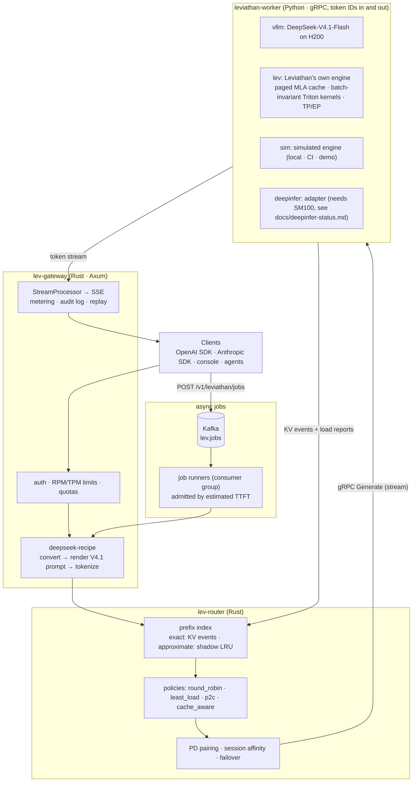
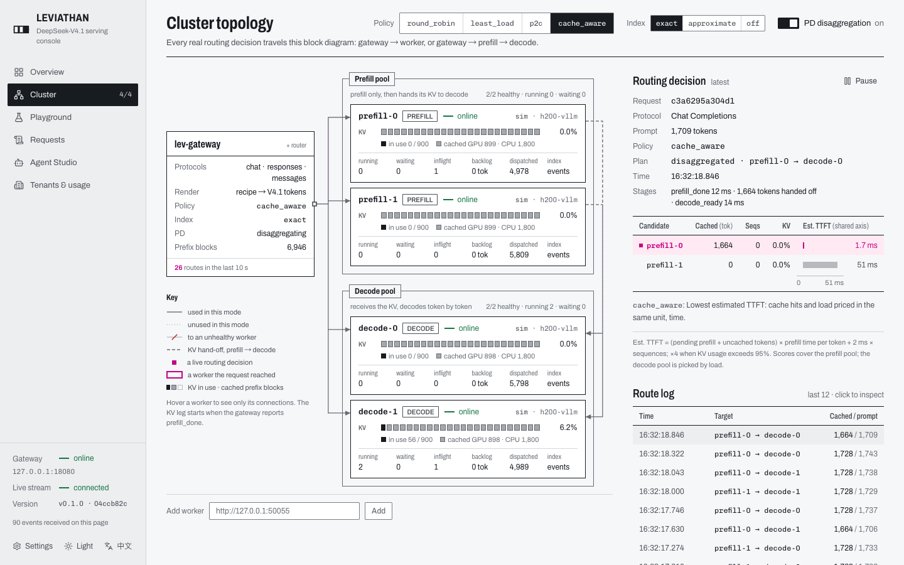

# Leviathan

**English** | [中文](README.zh.md)

**An enterprise serving platform for DeepSeek-V4.1**, built on DeepSeek's open-source [deepseek-recipe](https://github.com/deepseek-ai/deepseek-recipe) protocol layer. It supplies the three pieces the [DeepInfer](https://github.com/deepseek-ai/DeepInfer) release leaves out: a KV cache system, prefill/decode disaggregation, and load balancing across data-parallel replicas.

> Status: work in progress. See the [roadmap](#roadmap).

## Why

In October 2026 DeepSeek open-sourced two components:

| Component | Provides | Leaves to the caller |
| --- | --- | --- |
| **DeepInfer** | DeepSeek's production inference engine (offline), FlashMLA / DeepGEMM / DeepEP kernels, DSpark speculative decoding, batch-invariant deterministic inference | Per its README: "a KV cache system, VE/Prefill/Decode disaggregation, load balancing across data-parallel replicas". Runs on SM100 / Ascend 950 only |
| **deepseek-recipe** | Chat Completions / Responses / Messages ↔ conversation conversion, V4 / V4.1 prompt rendering and tokenization, streaming output parsing (reasoning, tool calls, structured output) | "The caller must provide model inference, tool execution, and HTTP transport" |

What is missing between them is an **online serving system**: multi-protocol APIs, tenants and quotas, cache-aware routing, PD-disaggregated scheduling, observability and an operations console. Leviathan is that system.

## Architecture



Design points:

- **The gateway tokenizes; workers only see token IDs.** The router can therefore compute token-level prefix matches, and usage (including `reasoning_tokens`) is metered in one place.
- **One block-hash convention** (header of `proto/leviathan/worker/v1/worker.proto`): a chained xxh3 hash shared by the Rust router and the Python workers, pinned by a cross-language test vector. vLLM's salted block hashes are translated into it inside the worker.
- **Cache-aware routing is TTFT minimization**: cache hits and load are both converted into estimated time to first token, so the trade-off has a physical unit instead of a tuning weight.
- **Bursts wait in Kafka, not in the engines.** Batch work goes to `POST /v1/leviathan/jobs`; runners in a Kafka consumer group start a job only while the router's estimated queueing delay stays under a bound, so interactive requests keep their latency and a dead gateway's jobs move to another.
- **An engine of its own** (`engine/`, `--backend lev`): DeepSeek-V2 (MLA + MoE) and Qwen3 on a paged cache whose block hashes are the router's, continuous batching with chunked prefill, priorities and recompute preemption, and batch-invariant Triton kernels plus counter-based sampling, so a request's tokens do not depend on its batch. Speculative decoding (n-gram lookup, or a draft model sampling with the target's noise) whose output is exactly plain decoding's. Tensor and expert parallelism over NCCL. Checked against transformers in float64.
- **An RL loop on top** (`rl/`): GRPO with lev-engine rollouts, weight sync into the engine, and the training-inference logprob mismatch measured every step.
- **Deterministic replay**: every request's token IDs, sampling parameters and seed are in the audit log, so a request can be re-run and diffed token by token.

## Results so far (sim backend)

The numbers below come from the **sim backend** with a placeholder H200 profile (`worker/leviathan_worker/profiles/h200-vllm.json` says so). The relative comparison is meaningful; absolute values wait for the H200 + vLLM runs.

**Cache-aware routing**: 8 replicas, 96 agents with ~1.7k-token system prompts, 800 KV blocks per replica, 32 concurrent requests ([details](docs/illustrated/04-cache-aware-routing.md)):

| Policy | TTFT p50 | TTFT p99 | E2E p50 | Output tok/s | Prefix hit rate |
| --- | --- | --- | --- | --- | --- |
| round_robin | 43.8 ms | 248.1 ms | 371.8 ms | 3901 | 49.1% |
| least_load | 81.9 ms | 295.0 ms | 397.2 ms | 3658 | 47.2% |
| p2c | 75.4 ms | 295.9 ms | 384.5 ms | 3776 | 46.8% |
| **cache_aware** | **33.6 ms** | **243.2 ms** | **310.5 ms** | **4517** | **73.5%** |

**PD disaggregation is a trade-off, not a free win**: same 4-replica budget, long unique prompts of 4.2k tokens ([details](docs/illustrated/05-pd-disaggregation.md)):

| Layout | TTFT p50 | TPOT p50 | TPOT p99 | E2E p50 | Output tok/s |
| --- | --- | --- | --- | --- | --- |
| 4 unified | **160.7 ms** | 8.81 ms | 12.07 ms | 2403 ms | 3153 |
| 2 prefill + 2 decode | 757.0 ms | **5.64 ms** | **6.64 ms** | **2121 ms** | **3337** |

**Bursts through Kafka**: 8 interactive clients on 4 replicas, then 2000 batch requests at once ([details](docs/illustrated/09-bursts-and-kafka.md)):

| Burst sent as | Burst finished in | Interactive TTFT p99 | Interactive req/s |
| --- | --- | --- | --- |
| no burst | – | 40.7 ms | 22.4 |
| directly to `/v1/chat/completions` | 42.4 s | 38 047 ms | 1.0 |
| jobs via Kafka, 32 in flight / 50 ms bound | 116.1 s | **100.5 ms** | 15.4 |
| jobs via Kafka, 512 in flight / 2000 ms bound | 44.7 s | 524.0 ms | 2.4 |

Two gateways sharing the queue, one killed with `kill -9` mid-burst: all 2000 jobs succeeded; the 32 it had in flight ran again on the other.

## Console

[apps/console](apps/console) is the cluster's live datasheet: a block diagram of the gateway and worker pools with every routing decision drawn as it happens, rolling KPIs with their window and sample size, a Prompt Inspector, the request audit with token-level replay, tenants and usage, and an agent studio. English by default, with a 中文 toggle.



## Quick start

```sh
python3 -m venv .venv && .venv/bin/pip install -e 'worker[dev]' openai anthropic
scripts/dev.sh unified 4          # 4 sim workers + gateway on http://127.0.0.1:8080
.venv/bin/python scripts/smoke.py # official OpenAI + Anthropic SDKs: 10 checks
target/release/lev-bench --workload agent-shared-prefix --requests 200 --concurrency 16
scripts/dev.sh stop
```

The gateway speaks the OpenAI and Anthropic APIs, so any SDK works with `base_url=http://127.0.0.1:8080/v1` (OpenAI) or `http://127.0.0.1:8080` (Anthropic) and model `deepseek-flash`.

With Docker: `docker compose -f deploy/compose/docker-compose.yml up --build` starts 2 prefill + 2 decode sim workers, Kafka, the gateway, the console, Prometheus and a Grafana dashboard.

Asynchronous jobs (in-process queue by default, Kafka with `deploy/local/kafka.toml`):

```sh
curl -s localhost:8080/v1/leviathan/jobs -H 'content-type: application/json' -d '{"jobs": [
  {"endpoint": "/v1/chat/completions", "custom_id": "q1",
   "body": {"model": "deepseek-flash", "messages": [{"role": "user", "content": "Summarize KV caching"}]}}]}'
curl -s localhost:8080/v1/leviathan/jobs/<id>      # queued → running → succeeded, with the response
```

Requirements: Rust ≥ 1.88, Python ≥ 3.10, `protoc`.

## Backends and hardware

| Backend | Runs on | Purpose |
| --- | --- | --- |
| `vllm` | Northeastern Explorer cluster, H200 | real engine baseline. DeepSeek-V4.1-Flash (TP4 per replica) does **not** fit Explorer's QoS (at most 2 GPUs per job), so it is measured on models that fit one or two H200s |
| `lev` | H200 (1-2 GPUs, TP2 / EP2), or CPU for tests | Leviathan's own engine: DeepSeek-V2-Lite, Qwen3 |
| `sim` | laptop / Docker / CI | development and demos; cost model to be fitted to H200 measurements |
| `deepinfer` | needs SM100 (B200/GB200) or Ascend 950 | adapter with interface tests; **not run on real hardware**, see [docs/deepinfer-status.md](docs/deepinfer-status.md) |

## Repository layout

```
proto/                 worker gRPC protocol (the only cross-language contract)
crates/lev-proto       generated Rust gRPC types
crates/lev-gateway     multi-protocol gateway (deepseek-recipe), admin API, audit, metrics, job queue (Kafka)
crates/lev-router      prefix index, routing policies, PD pairing
crates/lev-control     tenants, API keys, rate limits, quotas, usage ledger (memory / Postgres / Redis)
crates/lev-bench       load generator, policy comparison, burst experiment (lev-burst)
worker/                Python workers: sim / vllm / lev / deepinfer backends
engine/                lev-engine: models, paged KV cache, scheduler, sampler, Triton kernels, TP/EP
rl/                    GRPO loop: lev-engine rollouts, transformers trainer, weight sync
bench/engine, bench/nccl   engine parity / invariance / throughput / kernel and NCCL collective benchmarks
apps/console           web console
assets/tokenizers/v41  DeepSeek V4.1 tokenizer (MIT, from deepseek-recipe; notice kept)
deploy/                Docker · docker compose · Explorer Slurm scripts
docs/                  illustrated walkthrough, DeepInfer status, planning notes
```

## Docs: Leviathan, illustrated

[docs/illustrated/](docs/illustrated/README.md) follows one request through the system, with diagrams and real data at every step:

1. [The life of a request](docs/illustrated/01-request-lifecycle.md)
2. [How deepseek-recipe turns a request into tokens](docs/illustrated/02-recipe-protocol.md): the three protocols render to the same tokens, so they share KV cache
3. [Block hashes and the prefix index](docs/illustrated/03-prefix-index.md)
4. [Cache-aware routing = minimizing estimated TTFT](docs/illustrated/04-cache-aware-routing.md), including a bug found with benchmark data
5. [Prefill/decode disaggregation](docs/illustrated/05-pd-disaggregation.md)
6. [The simulated engine](docs/illustrated/06-sim-engine.md)
7. [vLLM on H200](docs/illustrated/07-vllm-on-h200.md)
8. [Observability and replay](docs/illustrated/08-observability-and-replay.md)
9. [Bursts, Kafka and admission control](docs/illustrated/09-bursts-and-kafka.md): the burst experiment, the Pareto curve, failover with a killed gateway
10. [Leviathan's own engine](docs/illustrated/10-lev-engine.md): the MLA latent cache, chunked prefill and preemption traced step by step, batch invariance
11. [Speculative decoding](docs/illustrated/11-speculative-decoding.md): drafts decide how many tokens a step confirms, never which; shared-noise drafting; a prefix-cache bug it exposed

## Roadmap

- [x] P0 scaffolding: workspace, worker protocol, cross-language block hashes, CI
- [x] P1 protocol path: three APIs (JSON + SSE) end to end through sim workers; official SDK smoke test 10/10
- [x] P2 router: exact / approximate prefix index, four policies, PD pairing, session affinity, in-flight accounting
- [ ] P3 real backends
  - [x] vLLM backend (in-process AsyncLLM, KV event re-hashing, DSpark stats, NIXL hand-off) and DeepInfer adapter (fake-engine tests)
  - [x] Explorer deployment scripts (environment, weights, two replicas + gateway; bench / serve / pd modes)
  - [ ] run on H200
- [ ] P4 enterprise features
  - [x] control plane: tenants, SHA-256-stored API keys, RPM/TPM token buckets (in-process or Redis), monthly quotas, usage ledger (memory or Postgres)
  - [x] audit log, per-request stage timeline, token-level replay; Prometheus metrics and Grafana dashboard
  - [x] asynchronous jobs: Kafka queue (consumer group, out-of-order-safe offset commits, at-least-once with idempotent claims), admission by estimated TTFT, engine priority
  - [ ] OpenTelemetry export
- [x] P5 console and agent studio (Live Datasheet design, English + 中文)
- [ ] P6 benchmarks on H200: four policies vs `vllm-router`, Pareto curves
- [ ] P7 lev-engine
  - [x] DeepSeek-V2 (absorbed MLA, DeepSeekMoE) and Qwen3; paged cache, prefix cache in the router's hashes, chunked prefill, priorities, preemption; worker backend; DeepSeek-V2 chat template in the gateway
  - [x] batch-invariant Triton kernels (GEMM, MLA and GQA attention, grouped MoE, RMSNorm) and seeded Gumbel-max sampling
  - [x] tensor and expert parallelism (TP2 / EP2 with DP attention), checked against one process
  - [x] speculative decoding: n-gram and draft-model proposers, verification that keeps plain decoding's output (bit for bit on invariant kernels), verify CUDA graphs; H200 run written (`spec_h200.sbatch`), not yet queued
  - [ ] H200 measurements: parity with transformers, invariance, kernels, throughput vs vLLM, TP2 / EP2, NCCL tuning (jobs written, queued)
  - [ ] CUDA graphs and overlapped scheduling
- [ ] P8 RL: GRPO loop with weight sync and mismatch metrics (CPU-tested), H200 run pending

## Development

```sh
make check        # cargo test + pytest (worker, engine, rl)
make lint         # clippy -D warnings
make proto-py     # generate the Python gRPC stubs
```

## License

MIT. The tokenizer files under `assets/tokenizers/` come from deepseek-recipe (MIT, Copyright (c) 2023 DeepSeek); see [assets/tokenizers/LICENSE](assets/tokenizers/LICENSE).
