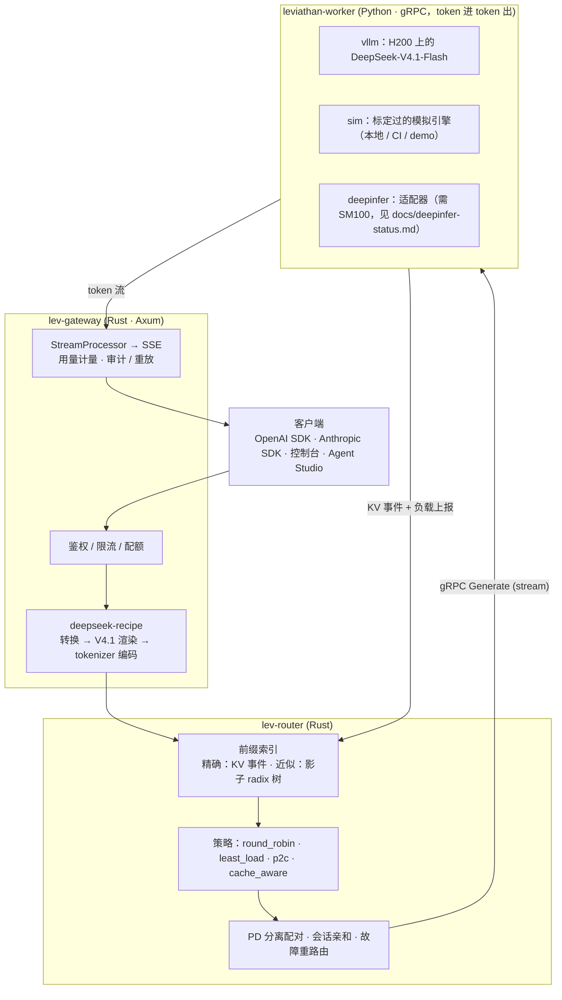

# Leviathan

**面向 DeepSeek-V4.1 的企业级推理服务与智能体平台**：协议层基于 [deepseek-recipe](https://github.com/deepseek-ai/deepseek-recipe)，服务层补上 [DeepInfer](https://github.com/deepseek-ai/DeepInfer) 开源版声明缺失的三块：KV cache 系统、Prefill/Decode 分离、DP 副本负载均衡。

> 状态：开发中（WIP）。进度见下方 [路线图](#路线图)。

## 为什么做这个

DeepSeek 在 2026 年 10 月开源了两个组件：

| 组件 | 提供什么 | 不提供什么 |
| --- | --- | --- |
| **DeepInfer** | DeepSeek 生产推理引擎（离线推理）、FlashMLA / DeepGEMM / DeepEP kernel、DSpark 投机解码、batch-invariant 确定性推理 | README 明确列出：KV cache 系统、VE/Prefill/Decode 分离、DP 副本间负载均衡；仅支持 SM100 / 昇腾 950 |
| **deepseek-recipe** | Chat Completions / Responses / Messages 三种协议 ↔ Conversation 转换，V4/V4.1 prompt 渲染与 tokenizer 编解码，流式输出解析（思考、工具调用、结构化输出） | 推理、HTTP、鉴权（“caller must provide model inference, tool execution, and HTTP transport”） |

两者之间缺的正是一层**在线服务系统**：多协议 API、多租户、缓存感知路由、PD 分离调度、可观测性和运维界面。Leviathan 就是这一层。

## 架构



关键设计：

- **网关做 tokenize，worker 只做 token 进 token 出。** 路由器因此能按 token 级前缀精确计算缓存命中；用量（含 `reasoning_tokens`）由 recipe 统一统计。
- **统一的块哈希约定**（`proto/leviathan/worker/v1/worker.proto` 头部）：Rust 路由器和 Python worker 用同一个 xxh3 链式哈希，跨语言测试向量保证一致。
- **两种前缀索引模式**：精确模式订阅 worker 的 KV 事件；近似模式在路由器侧维护影子树，用于事件不可用的后端。
- **确定性重放**：每个请求的 token IDs、采样参数和 seed 记入审计日志，可重放并逐 token diff。

## 硬件与后端

| 后端 | 运行位置 | 用途 |
| --- | --- | --- |
| `vllm` | Northeastern Explorer 集群 H200×8（每副本 TP4，一节点两副本） | 真实模型、真实 benchmark |
| `sim` | 本地 / Docker / CI | 开发与演示；耗时模型用 H200 实测数据拟合 |
| `deepinfer` | 需要 SM100（B200/GB200）或昇腾 950 | 适配器 + 接口测试；**未在真实硬件上运行**，原因见 [docs/deepinfer-status.md](docs/deepinfer-status.md) |

## 仓库结构

```
proto/                 worker gRPC 协议（唯一的跨语言契约）
crates/lev-proto       生成的 Rust gRPC 类型
crates/lev-gateway     多协议网关（deepseek-recipe）
crates/lev-router      前缀索引、调度策略、PD 配对
crates/lev-control     租户 / 密钥 / 配额 / 用量 / 审计
crates/lev-bench       压测与策略对比
worker/                Python worker：sim / vllm / deepinfer 后端
assets/tokenizers/v41  DeepSeek V4.1 tokenizer（MIT，来自 deepseek-recipe，保留原许可声明）
deploy/                docker compose · Helm · Slurm（Explorer H200）
docs/                  设计文档、benchmark、DeepInfer 状态说明
```

## 路线图

- [x] P0 脚手架：workspace、worker 协议、跨语言块哈希约定、CI
- [ ] P1 协议链路：网关三协议 + sim 后端端到端，OpenAI / Anthropic SDK 冒烟
  - [x] 网关：三协议（JSON + SSE）、Prompt Inspector、PD 两段式派发、失败重试、审计 / 重放、Prometheus 指标、运行时切换路由策略
  - [x] 16 个端到端测试（进程内 mock worker + 真实 V4.1 tokenizer）
  - [x] sim worker（Python）：连续批处理、分块 prefill、GPU/CPU 分层前缀缓存、DSpark 投机解码模拟、PD 交接、合法的思考 / JSON / 正则 / DSML 输出；158 个测试
  - [x] 官方 OpenAI / Anthropic SDK 冒烟（`scripts/smoke.py`）：10/10 通过
- [x] P2 路由器：精确 / 近似前缀索引、4 种策略、PD 配对、会话亲和、in-flight 记账（29 个测试，含 proptest）
- [ ] P3 真实后端
  - [x] vLLM 后端（进程内 AsyncLLM，KV 事件重哈希翻译，DSpark 统计，NIXL PD 交接）与 DeepInfer 适配器（step 循环线程 + fake engine 接口测试）
  - [x] Explorer 部署脚本（`deploy/slurm`：环境、权重下载、两副本 + 网关、bench/serve/pd 三种模式）
  - [ ] 在 H200 上实际运行
- [ ] P4 企业功能
  - [x] 控制面 `lev-control`：租户、API key（SHA-256 存储）、RPM/TPM 令牌桶（进程内或 Redis 共享）、月度配额、用量账本（内存或 Postgres，批量异步写入）；Postgres/Redis 集成测试
  - [x] 审计日志 + 逐 token 重放 diff；Prometheus 指标 + Grafana 看板（`dashboards/grafana`）
  - [ ] OpenTelemetry 链路追踪
- [ ] P5 控制台 + Agent Studio
- [ ] P6 Benchmark：4 种策略 vs `vllm-router`，Pareto 曲线

## 文档：图解 Leviathan

[docs/illustrated/](docs/illustrated/README.md) 跟着一个请求走完全程，每一站都配图并附上实际运行得到的数据：

1. [一个请求的一生](docs/illustrated/01-request-lifecycle.md)
2. [deepseek-recipe 把请求变成 token](docs/illustrated/02-recipe-protocol.md)：三种协议渲染成同一串 token，因此共享 KV cache
3. [块哈希与前缀索引](docs/illustrated/03-prefix-index.md)
4. [cache-aware 路由 = 最小化预计 TTFT](docs/illustrated/04-cache-aware-routing.md)

## 开发

```sh
make check        # cargo test + pytest
make proto-py     # 生成 Python gRPC 代码
```

需要：Rust ≥ 1.88、Python ≥ 3.10、`protoc`。

## 许可

MIT。`assets/tokenizers/` 下的 tokenizer 文件来自 deepseek-recipe（MIT，Copyright (c) 2023 DeepSeek），许可声明见 [assets/tokenizers/LICENSE](assets/tokenizers/LICENSE)。
