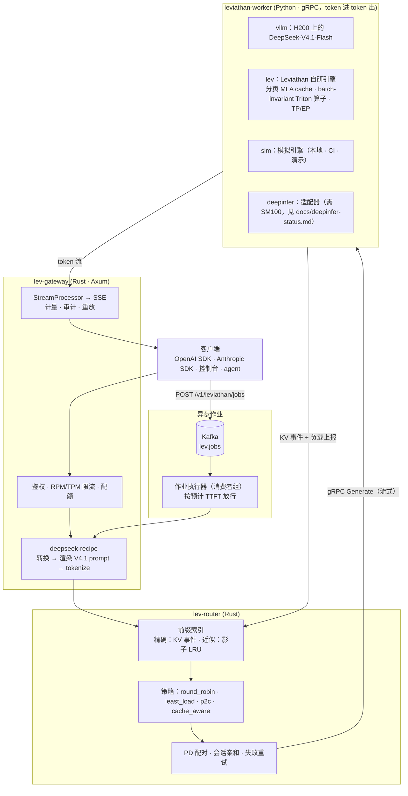
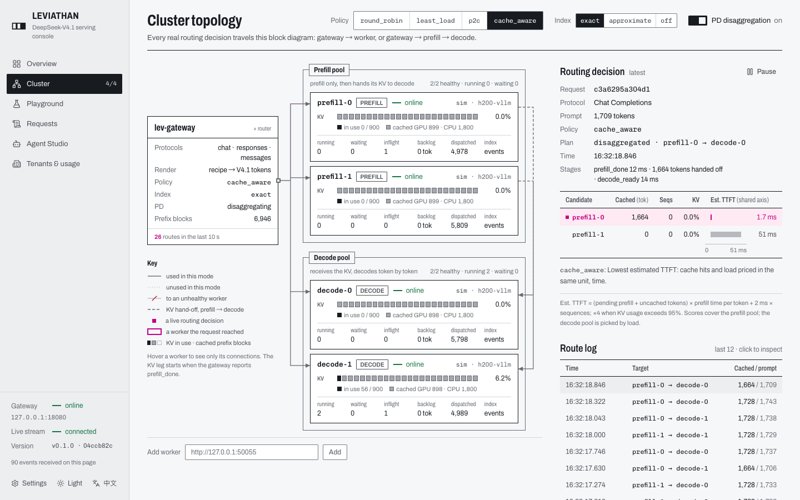

# Leviathan

[English](README.md) | **中文**

**面向 DeepSeek-V4.1 的企业级推理服务平台**。协议层基于 DeepSeek 开源的 [deepseek-recipe](https://github.com/deepseek-ai/deepseek-recipe)；服务层补上 [DeepInfer](https://github.com/deepseek-ai/DeepInfer) 开源版声明缺失的三块：KV cache 系统、Prefill/Decode 分离、DP 副本负载均衡。

> 状态：开发中，进度见[路线图](#路线图)。仓库文档以英文为准（`docs/` 为英文）。

## 为什么做这个

DeepSeek 在 2026 年 10 月开源了两个组件：

| 组件 | 提供什么 | 留给调用方的 |
| --- | --- | --- |
| **DeepInfer** | DeepSeek 生产推理引擎（离线）、FlashMLA / DeepGEMM / DeepEP kernel、DSpark 投机解码、batch-invariant 确定性推理 | README 原文列出：KV cache 系统、VE/Prefill/Decode 分离、DP 副本间负载均衡；仅支持 SM100 / 昇腾 950 |
| **deepseek-recipe** | Chat Completions / Responses / Messages ↔ Conversation 转换，V4 / V4.1 prompt 渲染与 tokenize，流式输出解析（思考、工具调用、结构化输出） | “The caller must provide model inference, tool execution, and HTTP transport” |

两者之间缺的是一层**在线服务系统**：多协议 API、租户与配额、缓存感知路由、PD 分离调度、可观测性和运维控制台。Leviathan 就是这一层。

## 架构



关键设计：

- **网关负责 tokenize，worker 只收发 token ID。** 路由器因此能做 token 级的前缀匹配，用量（含 `reasoning_tokens`）也在同一处计量。
- **统一的块哈希约定**（见 `proto/leviathan/worker/v1/worker.proto` 文件头）：Rust 路由器和 Python worker 用同一个 xxh3 链式哈希，跨语言测试向量保证两边一致。vLLM 带盐的块哈希在 worker 内翻译成这套约定。
- **cache-aware 路由就是最小化预计 TTFT**：缓存命中和负载都换算成“预计首 token 时间”，取舍有物理单位，不靠调权重。
- **突发流量在 Kafka 里排队，而不是堆在引擎里。** 批量任务走 `POST /v1/leviathan/jobs`；Kafka 消费者组里的执行器只在路由器估计的排队时延低于上限时才启动作业，交互请求的延迟因此不受影响，某个网关挂掉后它的作业会转给其他网关。
- **自研推理引擎**（`engine/`，`--backend lev`）：支持 DeepSeek-V2（MLA + MoE）和 Qwen3。分页 KV cache 的块哈希与路由器一致；连续批处理带分块 prefill、优先级和重算式抢占；Triton 算子和基于计数器哈希的采样都是 batch-invariant 的，请求的输出不随同批的其他请求变化。投机解码（n-gram 查找，或用与目标模型相同噪声采样的 draft 模型）的输出与逐个解码完全一致。通过 NCCL 支持张量并行和专家并行。数值在 float64 下与 transformers 对齐。
- **在它之上的 RL 闭环**（`rl/`）：GRPO，rollout 用 lev-engine，权重同步回引擎，每一步都测量训练与推理之间的 logprob 差异。
- **确定性重放**：每个请求的 token ID、采样参数和 seed 都进审计日志，可以原样重跑，并逐 token 对比两次输出。

## 目前的结果（sim 后端）

以下数字来自 **sim 后端**，用的是 H200 占位 profile（`worker/leviathan_worker/profiles/h200-vllm.json` 中已注明是占位值）。能下结论的是相对关系，绝对值要等 H200 + vLLM 的实测。

**cache-aware 路由**：8 副本，96 个 agent（系统提示约 1.7k token），每副本 800 个 KV 块，32 并发（[详情](docs/illustrated/04-cache-aware-routing.md)）：

| 策略 | TTFT p50 | TTFT p99 | E2E p50 | 输出 tok/s | 前缀命中率 |
| --- | --- | --- | --- | --- | --- |
| round_robin | 43.8 ms | 248.1 ms | 371.8 ms | 3901 | 49.1% |
| least_load | 81.9 ms | 295.0 ms | 397.2 ms | 3658 | 47.2% |
| p2c | 75.4 ms | 295.9 ms | 384.5 ms | 3776 | 46.8% |
| **cache_aware** | **33.6 ms** | **243.2 ms** | **310.5 ms** | **4517** | **73.5%** |

**PD 分离是一笔交换，不是白给的收益**：同样 4 个副本，长且互不重复的 prompt（4.2k token）（[详情](docs/illustrated/05-pd-disaggregation.md)）：

| 布局 | TTFT p50 | TPOT p50 | TPOT p99 | E2E p50 | 输出 tok/s |
| --- | --- | --- | --- | --- | --- |
| 4 个 unified | **160.7 ms** | 8.81 ms | 12.07 ms | 2403 ms | 3153 |
| 2 prefill + 2 decode | 757.0 ms | **5.64 ms** | **6.64 ms** | **2121 ms** | **3337** |

**用 Kafka 吸收突发流量**：4 个副本上跑着 8 个交互客户端，此时一次性涌入 2000 个批量请求（[详情](docs/illustrated/09-bursts-and-kafka.md)）：

| 突发请求的发送方式 | 突发全部完成用时 | 交互 TTFT p99 | 交互请求数/秒 |
| --- | --- | --- | --- |
| 无突发 | – | 40.7 ms | 22.4 |
| 直接打到 `/v1/chat/completions` | 42.4 s | 38 047 ms | 1.0 |
| 经 Kafka 作业队列，并发 32 / 时延上限 50 ms | 116.1 s | **100.5 ms** | 15.4 |
| 经 Kafka 作业队列，并发 512 / 时延上限 2000 ms | 44.7 s | 524.0 ms | 2.4 |

两个网关共享同一个队列，突发进行中对其中一个执行 `kill -9`：2000 个作业全部成功，被杀网关上正在执行的 32 个作业由另一个网关重新执行。

## 控制台

[apps/console](apps/console) 是集群的“实时规格书”：网关与 worker 池的框图，实时画出每一次路由决策；滚动 KPI（标明窗口与样本数）；Prompt Inspector；请求审计与逐 token 重放；租户与用量；agent studio。默认英文，可切换中文。



## 快速开始

```sh
python3 -m venv .venv && .venv/bin/pip install -e 'worker[dev]' openai anthropic
scripts/dev.sh unified 4          # 4 个 sim worker + 网关，监听 http://127.0.0.1:8080
.venv/bin/python scripts/smoke.py # 官方 OpenAI + Anthropic SDK，10 项检查
target/release/lev-bench --workload agent-shared-prefix --requests 200 --concurrency 16
scripts/dev.sh stop
```

网关兼容 OpenAI 和 Anthropic 协议，任何 SDK 都可以直接用：OpenAI 设 `base_url=http://127.0.0.1:8080/v1`，Anthropic 设 `http://127.0.0.1:8080`，模型名 `deepseek-flash`。

Docker：`docker compose -f deploy/compose/docker-compose.yml up --build`，启动 2 prefill + 2 decode sim worker、Kafka、网关、控制台、Prometheus 和 Grafana 看板。

异步作业（默认用进程内队列，用 `deploy/local/kafka.toml` 切到 Kafka）：

```sh
curl -s localhost:8080/v1/leviathan/jobs -H 'content-type: application/json' -d '{"jobs": [
  {"endpoint": "/v1/chat/completions", "custom_id": "q1",
   "body": {"model": "deepseek-flash", "messages": [{"role": "user", "content": "Summarize KV caching"}]}}]}'
curl -s localhost:8080/v1/leviathan/jobs/<id>      # queued → running → succeeded，附带响应
```

环境要求：Rust ≥ 1.88、Python ≥ 3.10、`protoc`。

## 后端与硬件

| 后端 | 运行位置 | 用途 |
| --- | --- | --- |
| `vllm` | Northeastern Explorer 集群 H200 | 真实引擎基线。DeepSeek-V4.1-Flash（每副本 TP4）**不符合** Explorer 的 QoS（每作业最多 2 张卡），因此用 1–2 张 H200 放得下的模型测量 |
| `lev` | H200（1–2 张卡，TP2 / EP2），测试时用 CPU | Leviathan 自研引擎：DeepSeek-V2-Lite、Qwen3 |
| `sim` | 笔记本 / Docker / CI | 开发与演示；耗时模型待用 H200 实测拟合 |
| `deepinfer` | 需要 SM100（B200/GB200）或昇腾 950 | 适配器 + 接口测试；**未在真实硬件上运行**，见 [docs/deepinfer-status.md](docs/deepinfer-status.md) |

## 仓库结构

```
proto/                 worker gRPC 协议（唯一的跨语言契约）
crates/lev-proto       生成的 Rust gRPC 类型
crates/lev-gateway     多协议网关（deepseek-recipe）、管理 API、审计、指标、作业队列（Kafka）
crates/lev-router      前缀索引、路由策略、PD 配对
crates/lev-control     租户、API key、限流、配额、用量账本（内存 / Postgres / Redis）
crates/lev-bench       压测器、策略对比、突发实验（lev-burst）
worker/                Python worker：sim / vllm / lev / deepinfer 后端
engine/                lev-engine：模型、分页 KV cache、调度器、采样器、Triton 算子、TP/EP
rl/                    GRPO 闭环：lev-engine rollout、transformers 训练端、权重同步
bench/engine, bench/nccl   引擎数值对齐 / invariance / 吞吐 / 算子与 NCCL 集合通信 benchmark
apps/console           Web 控制台
assets/tokenizers/v41  DeepSeek V4.1 tokenizer（MIT，来自 deepseek-recipe，保留原许可声明）
deploy/                Docker · docker compose · Explorer Slurm 脚本
docs/                  图解文档（英文）、DeepInfer 状态说明、规划笔记
```

## 文档：图解 Leviathan（英文）

[docs/illustrated/](docs/illustrated/README.md) 跟着一个请求走完全程，每一站都配图，并附实际运行得到的数据：

1. [一个请求的一生](docs/illustrated/01-request-lifecycle.md)
2. [deepseek-recipe 如何把请求变成 token](docs/illustrated/02-recipe-protocol.md)：三种协议渲染出同一串 token，因此共享 KV cache
3. [块哈希与前缀索引](docs/illustrated/03-prefix-index.md)
4. [cache-aware 路由 = 最小化预计 TTFT](docs/illustrated/04-cache-aware-routing.md)，含一个靠压测数据发现的 bug
5. [Prefill/Decode 分离](docs/illustrated/05-pd-disaggregation.md)
6. [模拟引擎](docs/illustrated/06-sim-engine.md)
7. [H200 上的 vLLM](docs/illustrated/07-vllm-on-h200.md)
8. [可观测性与重放](docs/illustrated/08-observability-and-replay.md)
9. [突发流量、Kafka 与准入控制](docs/illustrated/09-bursts-and-kafka.md)：突发实验、Pareto 曲线、杀掉一个网关后的故障转移
10. [Leviathan 自研引擎](docs/illustrated/10-lev-engine.md)：MLA 潜在向量 cache、逐步追踪分块 prefill 与抢占、batch invariance
11. [投机解码](docs/illustrated/11-speculative-decoding.md)：draft 只决定一步确认几个 token，不决定是哪些；共享噪声的 draft 采样；顺带发现的一个前缀缓存 bug

## 路线图

- [x] P0 脚手架：workspace、worker 协议、跨语言块哈希、CI
- [x] P1 协议链路：三种 API（JSON + SSE）经 sim worker 端到端打通；官方 SDK 冒烟 10/10
- [x] P2 路由器：精确 / 近似前缀索引、4 种策略、PD 配对、会话亲和、in-flight 记账
- [ ] P3 真实后端
  - [x] vLLM 后端（进程内 AsyncLLM、KV 事件重哈希、DSpark 统计、NIXL 交接）与 DeepInfer 适配器（fake engine 测试）
  - [x] Explorer 部署脚本（环境、权重、双副本 + 网关；bench / serve / pd 三种模式）
  - [ ] 在 H200 上实际运行
- [ ] P4 企业功能
  - [x] 控制面：租户、SHA-256 存储的 API key、RPM/TPM 令牌桶（进程内或 Redis）、月度配额、用量账本（内存或 Postgres）
  - [x] 审计日志、每请求阶段时间线、逐 token 重放；Prometheus 指标与 Grafana 看板
  - [x] 异步作业：Kafka 队列（消费者组、乱序完成也安全的 offset 提交、至少一次投递 + 幂等认领）、按预计 TTFT 准入、引擎优先级
  - [ ] OpenTelemetry 导出
- [x] P5 控制台与 agent studio（“实时规格书”设计，英文 + 中文）
- [ ] P6 H200 benchmark：4 种策略对比 `vllm-router`，Pareto 曲线
- [ ] P7 lev-engine
  - [x] DeepSeek-V2（吸收式 MLA、DeepSeekMoE）与 Qwen3；分页 cache、使用路由器哈希的前缀缓存、分块 prefill、优先级、抢占；worker 后端；网关支持 DeepSeek-V2 对话模板
  - [x] batch-invariant Triton 算子（GEMM、MLA 与 GQA 注意力、分组 MoE、RMSNorm）与带 seed 的 Gumbel-max 采样
  - [x] 张量并行与专家并行（TP2 / EP2 + DP 注意力），已与单进程结果对齐
  - [x] 投机解码：n-gram 与 draft 模型两种 proposer，验证规则保证输出与逐个解码一致（invariant 算子下逐位一致），verify 步的 CUDA Graph；H200 作业（`spec_h200.sbatch`）排在第四个，2 节点作业之后
  - [x] 单卡 H200 实测（作业 11707247）：用 batch-invariant 算子时，一个请求单独跑和夹在 64 个请求中间跑，128 个 logprob 逐位相等（cuBLAS 下只要多一个请求，token 就会分歧）；batch 256 时输出 4 168 tok/s，vLLM 为 11 709（未开 CUDA Graph）；invariance 带来 11% 的吞吐损失
  - [x] 双卡 H200（作业 11707602）：NVLink all-reduce 330 GB/s（NCCL 默认配置与最优参数只差 4%）；eager 模式下 decode 受主机端限制（batch 2 和 128 都是每步约 29 ms），所以 TP2（+11 ms）和 EP2（+22 ms，每个 MoE 层一次主机同步）都比单卡慢，而把 kernel 下发分到两个进程的 AFD 更快（5 214 vs 4 324 tok/s）；修了 AFD 死锁和代理问题；网关 + 路由 + 两个 lev worker 处理了 1 600 个请求、零错误，四种策略的缓存命中率都约 91%；跨两个节点只有 10 GbE 可用（InfiniBand 端口 down，NCCL 的 IB 传输在 RoCE 网卡上报错），走 socket 只有 1.23 GB/s
  - [ ] CUDA Graph 与重叠调度
- [x] P8 RL：GRPO 闭环（含权重同步与训推差异指标）；H200 上 Qwen3-1.7B（作业 11717781）：30 步内 reward 从 0.82 升到 0.91；用 batch-invariant kernel 时，引擎重算自己 rollout 的 logprob 100% 逐位相等（cuBLAS 只有 4.4%），但和 transformers trainer 的差距两种情况都是 0.006

## 开发

```sh
make check        # cargo test + pytest（worker、engine、rl）
make lint         # clippy -D warnings
make proto-py     # 生成 Python gRPC 代码
```

## 许可

MIT。`assets/tokenizers/` 下的 tokenizer 文件来自 deepseek-recipe（MIT，Copyright (c) 2023 DeepSeek），许可声明见 [assets/tokenizers/LICENSE](assets/tokenizers/LICENSE)。
