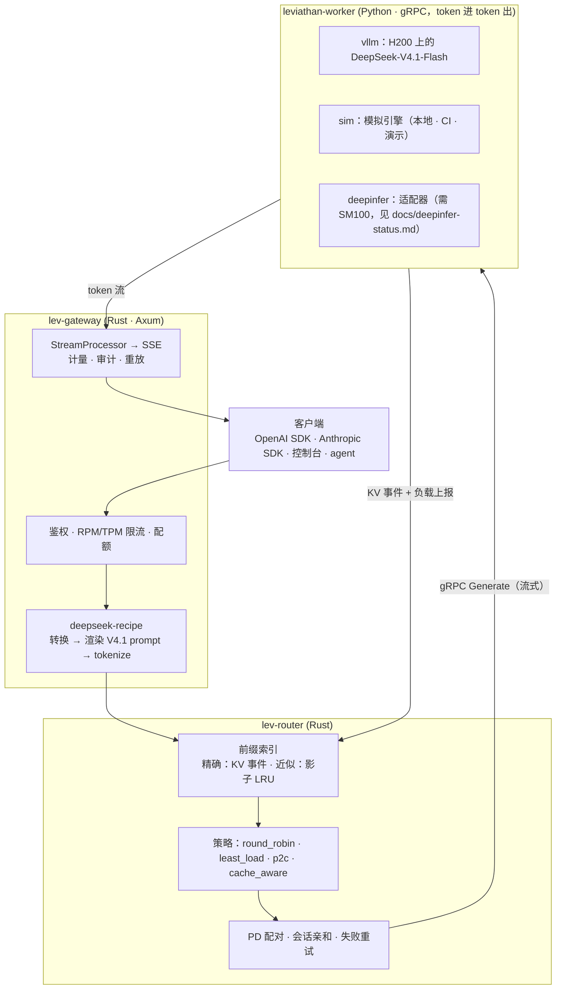

# Leviathan

[English](README.md) | **中文**

**面向 DeepSeek-V4.1 的企业级推理服务平台**。协议层基于 DeepSeek 开源的 [deepseek-recipe](https://github.com/deepseek-ai/deepseek-recipe)；服务层补上 [DeepInfer](https://github.com/deepseek-ai/DeepInfer) 开源版声明缺失的三块：KV cache 系统、Prefill/Decode 分离、DP 副本负载均衡。

> 状态：开发中，进度见[路线图](#路线图)。仓库文档以英文为准（`docs/` 为英文）。

## 为什么做这个

DeepSeek 在 2026 年 10 月开源了两个组件：

| 组件 | 提供什么 | 留给调用方的 |
| --- | --- | --- |
| **DeepInfer** | DeepSeek 生产推理引擎（离线）、FlashMLA / DeepGEMM / DeepEP kernel、DSpark 投机解码、batch-invariant 确定性推理 | README 原文列出：KV cache 系统、VE/Prefill/Decode 分离、DP 副本间负载均衡；仅支持 SM100 / 昇腾 950 |
| **deepseek-recipe** | Chat Completions / Responses / Messages ↔ Conversation 转换，V4 / V4.1 prompt 渲染与 tokenize，流式输出解析（思考、工具调用、结构化输出） | “The caller must provide model inference, tool execution, and HTTP transport” |

两者之间缺的是一层**在线服务系统**：多协议 API、租户与配额、缓存感知路由、PD 分离调度、可观测性和运维控制台。Leviathan 就是这一层。

## 架构



关键设计：

- **网关负责 tokenize，worker 只收发 token ID。** 路由器因此能做 token 级的前缀匹配，用量（含 `reasoning_tokens`）也在同一处计量。
- **统一的块哈希约定**（见 `proto/leviathan/worker/v1/worker.proto` 文件头）：Rust 路由器和 Python worker 用同一个 xxh3 链式哈希，跨语言测试向量保证两边一致。vLLM 带盐的块哈希在 worker 内翻译成这套约定。
- **cache-aware 路由就是最小化预计 TTFT**：缓存命中和负载都换算成“预计首 token 时间”，取舍有物理单位，不靠调权重。
- **确定性重放**：每个请求的 token ID、采样参数和 seed 都进审计日志，可以原样重跑，并逐 token 对比两次输出。

## 目前的结果（sim 后端）

以下数字来自 **sim 后端**，用的是 H200 占位 profile（`worker/leviathan_worker/profiles/h200-vllm.json` 中已注明是占位值）。能下结论的是相对关系，绝对值要等 H200 + vLLM 的实测。

**cache-aware 路由**：8 副本，96 个 agent（系统提示约 1.7k token），每副本 800 个 KV 块，32 并发（[详情](docs/illustrated/04-cache-aware-routing.md)）：

| 策略 | TTFT p50 | TTFT p99 | E2E p50 | 输出 tok/s | 前缀命中率 |
| --- | --- | --- | --- | --- | --- |
| round_robin | 43.8 ms | 248.1 ms | 371.8 ms | 3901 | 49.1% |
| least_load | 81.9 ms | 295.0 ms | 397.2 ms | 3658 | 47.2% |
| p2c | 75.4 ms | 295.9 ms | 384.5 ms | 3776 | 46.8% |
| **cache_aware** | **33.6 ms** | **243.2 ms** | **310.5 ms** | **4517** | **73.5%** |

**PD 分离是一笔交换，不是白给的收益**：同样 4 个副本，长且互不重复的 prompt（4.2k token）（[详情](docs/illustrated/05-pd-disaggregation.md)）：

| 布局 | TTFT p50 | TPOT p50 | TPOT p99 | E2E p50 | 输出 tok/s |
| --- | --- | --- | --- | --- | --- |
| 4 个 unified | **160.7 ms** | 8.81 ms | 12.07 ms | 2403 ms | 3153 |
| 2 prefill + 2 decode | 757.0 ms | **5.64 ms** | **6.64 ms** | **2121 ms** | **3337** |

## 快速开始

```sh
python3 -m venv .venv && .venv/bin/pip install -e 'worker[dev]' openai anthropic
scripts/dev.sh unified 4          # 4 个 sim worker + 网关，监听 http://127.0.0.1:8080
.venv/bin/python scripts/smoke.py # 官方 OpenAI + Anthropic SDK，10 项检查
target/release/lev-bench --workload agent-shared-prefix --requests 200 --concurrency 16
scripts/dev.sh stop
```

网关兼容 OpenAI 和 Anthropic 协议，任何 SDK 都可以直接用：OpenAI 设 `base_url=http://127.0.0.1:8080/v1`，Anthropic 设 `http://127.0.0.1:8080`，模型名 `deepseek-flash`。

Docker：`docker compose -f deploy/compose/docker-compose.yml up --build`，启动 2 prefill + 2 decode sim worker、网关、Prometheus 和 Grafana 看板。

环境要求：Rust ≥ 1.88、Python ≥ 3.10、`protoc`。

## 后端与硬件

| 后端 | 运行位置 | 用途 |
| --- | --- | --- |
| `vllm` | Northeastern Explorer 集群 8× H200（每节点两个 TP4 副本） | 真实模型、真实 benchmark |
| `sim` | 笔记本 / Docker / CI | 开发与演示；耗时模型待用 H200 实测拟合 |
| `deepinfer` | 需要 SM100（B200/GB200）或昇腾 950 | 适配器 + 接口测试；**未在真实硬件上运行**，见 [docs/deepinfer-status.md](docs/deepinfer-status.md) |

## 仓库结构

```
proto/                 worker gRPC 协议（唯一的跨语言契约）
crates/lev-proto       生成的 Rust gRPC 类型
crates/lev-gateway     多协议网关（deepseek-recipe）、管理 API、审计、指标
crates/lev-router      前缀索引、路由策略、PD 配对
crates/lev-control     租户、API key、限流、配额、用量账本（内存 / Postgres / Redis）
crates/lev-bench       压测器与策略对比
worker/                Python worker：sim / vllm / deepinfer 后端
apps/console           Web 控制台
assets/tokenizers/v41  DeepSeek V4.1 tokenizer（MIT，来自 deepseek-recipe，保留原许可声明）
deploy/                Docker · docker compose · Explorer Slurm 脚本
docs/                  图解文档（英文）、DeepInfer 状态说明、规划笔记
```

## 文档：图解 Leviathan（英文）

[docs/illustrated/](docs/illustrated/README.md) 跟着一个请求走完全程，每一站都配图，并附实际运行得到的数据：

1. [一个请求的一生](docs/illustrated/01-request-lifecycle.md)
2. [deepseek-recipe 如何把请求变成 token](docs/illustrated/02-recipe-protocol.md)：三种协议渲染出同一串 token，因此共享 KV cache
3. [块哈希与前缀索引](docs/illustrated/03-prefix-index.md)
4. [cache-aware 路由 = 最小化预计 TTFT](docs/illustrated/04-cache-aware-routing.md)，含一个靠压测数据发现的 bug
5. [Prefill/Decode 分离](docs/illustrated/05-pd-disaggregation.md)
6. [模拟引擎](docs/illustrated/06-sim-engine.md)
7. [H200 上的 vLLM](docs/illustrated/07-vllm-on-h200.md)

## 路线图

- [x] P0 脚手架：workspace、worker 协议、跨语言块哈希、CI
- [x] P1 协议链路：三种 API（JSON + SSE）经 sim worker 端到端打通；官方 SDK 冒烟 10/10
- [x] P2 路由器：精确 / 近似前缀索引、4 种策略、PD 配对、会话亲和、in-flight 记账
- [ ] P3 真实后端
  - [x] vLLM 后端（进程内 AsyncLLM、KV 事件重哈希、DSpark 统计、NIXL 交接）与 DeepInfer 适配器（fake engine 测试）
  - [x] Explorer 部署脚本（环境、权重、双副本 + 网关；bench / serve / pd 三种模式）
  - [ ] 在 H200 上实际运行
- [ ] P4 企业功能
  - [x] 控制面：租户、SHA-256 存储的 API key、RPM/TPM 令牌桶（进程内或 Redis）、月度配额、用量账本（内存或 Postgres）
  - [x] 审计日志、每请求阶段时间线、逐 token 重放；Prometheus 指标与 Grafana 看板
  - [ ] OpenTelemetry 导出
- [ ] P5 控制台与 agent studio
- [ ] P6 H200 benchmark：4 种策略对比 `vllm-router`，Pareto 曲线

## 开发

```sh
make check        # cargo test + pytest
make lint         # clippy -D warnings
make proto-py     # 生成 Python gRPC 代码
```

## 许可

MIT。`assets/tokenizers/` 下的 tokenizer 文件来自 deepseek-recipe（MIT，Copyright (c) 2023 DeepSeek），许可声明见 [assets/tokenizers/LICENSE](assets/tokenizers/LICENSE)。
