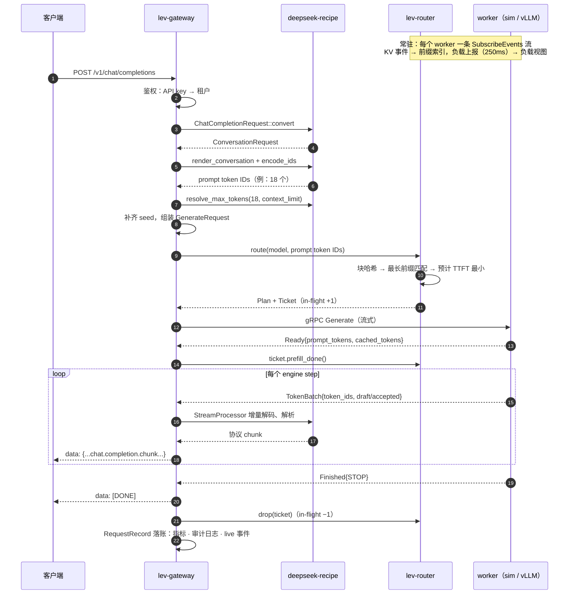
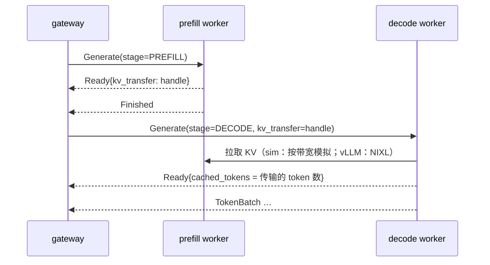

# 图解 01：一个请求的一生

> 对应代码：`crates/lev-gateway/src/pipeline.rs` 全文；协议定义 `proto/leviathan/worker/v1/worker.proto`
> 下一篇：[02 deepseek-recipe 把请求变成 token](02-recipe-protocol.md)

本篇跟着一个请求走完全程：

```sh
curl localhost:8080/v1/chat/completions -H 'content-type: application/json' -d '{
  "model": "deepseek-flash",
  "messages": [{"role": "user", "content": "北京今天天气怎么样？"}],
  "stream": true
}'
```

## 全程时序图



## 每一站产出什么

| # | 站点 | 产物 | 失败时 |
| --- | --- | --- | --- |
| 1 | 解析信封 | `model`、会话键（`x-session-id` / `prompt_cache_key` / `user`） | 400 `invalid_json` |
| 2 | 模型解析 | `ServedModel`（tokenizer、编码、上下文长度） | 404 `model_not_found`（按协议格式返回） |
| 3 | recipe 转换 | `ConversationRequest` | 400，透传 recipe 的错误信息 |
| 4 | 渲染 + 编码 | prompt token IDs | 有图片时返回 400 `unsupported_feature`（本阶段未开启） |
| 5 | `resolve_max_tokens` | 实际发送的 `max_tokens` | 400 `context_length_exceeded`，不派发 |
| 6 | 路由 | `RouteDecision`：unified 或 prefill+decode，以及每个候选的打分 | 503 `no_available_worker` |
| 7 | 派发 | worker 返回 `Ready`：prefill 完成，确认命中多少缓存 | 换一个 worker 重试（最多 3 次，见下） |
| 8 | 流式解析 | 每个 `TokenBatch` → 协议 chunk | 中途出错时，按协议格式追加一个 SSE 错误帧 |
| 9 | 落账 | Prometheus 指标、审计条目（可重放）、live 事件 | 客户端中途断开记为 `cancelled` |

## 两个关键边界

### 边界一：`Ready` 之前可以重试，之后不行

```
          可重试区                            │            不可重试区
route → Generate → (worker 排队) → prefill → Ready → TokenBatch → TokenBatch → … → Finished
                                           │
                       客户端还没收到任何字节   │   客户端已经收到部分输出
```

worker 在 `Ready` 之前失败（连不上、超时、prefill 出错）时，网关把它加入 `exclude` 并重新路由，客户端无感知（测试 `failover_skips_a_dead_worker`：一个宕机、一个正常，4 个请求全部成功）。`Ready` 之后再失败，已经发出的 token 无法撤回，只能按协议格式追加一个错误帧：

| 协议 | 中途错误帧 |
| --- | --- |
| Chat Completions | `data: {"error": {"message", "type", "code"}}` |
| Responses | `event: error` + `{"type": "error", "code", "message"}` |
| Messages | `event: error` + `{"type": "error", "error": {"type", "message"}}` |

### 边界二：谁持有负载

`Ticket` 从路由那一刻起就把负载记到选中的 worker 上，一直持有到流结束；客户端断开导致流被丢弃时，Ticket 随之释放。路由器因此始终看得到“已派发但 worker 还没上报”的请求（详见 [04](04-cache-aware-routing.md)）。

## PD 分离时多出来的一段



向客户端报告的 `cached_tokens` 取 **prefill 侧**的命中数：decode 侧通过传输拿到的 KV 不算缓存命中，因为该计算的 prefill 一个都没省。（测试 `disaggregated_requests_hand_kv_to_decode`。）

## 落账：一个请求留下了什么

`GET /admin/requests` 返回的每条审计记录包含以下字段：

| 字段 | 含义 |
| --- | --- |
| `request_id` / `response_id` | 网关内部 ID（UUIDv7）/ 客户端看到的 ID（`chatcmpl-…`、`resp_…`、`msg_…`） |
| `policy` / `plan` / `worker_id` / `prefill_worker_id` / `attempts` | 路由决策、实际执行的 worker、重试次数 |
| `prompt_tokens` / `cached_tokens` / `completion_tokens` | 用量，按租户计入 Prometheus |
| `seed` | 网关补齐的采样种子 |
| `ttft_ms` / `tpot_ms` / `e2e_ms` | 在网关测得的首 token 时间、每 token 时间、端到端时间 |
| `spec_draft_tokens` / `spec_accepted_tokens` | 投机解码（DSpark）的草稿数与接受数 |
| `outcome` / `finish_reason` / `error` | `ok` · `error` · `rejected` · `cancelled` |

> sim worker 接入后，这里会贴一条实际运行得到的记录。

审计记录同时保存了 worker 的**完整输入**（prompt token IDs、采样参数、seed、约束），因此 `POST /admin/requests/{id}/replay` 可以原样再跑一遍，并逐 token 比对两次输出（测试 `replay_reproduces_the_output`）。

## 为什么这样设计

- **为什么要等 `Ready` 才算派发成功？** 这是最后一个“客户端还什么都没收到”的时刻。在它之前失败可以透明重试，在它之后失败必须如实报错。把边界设在这里，重试是安全的：不会出现重复输出。
- **为什么负载记账放在 Ticket 里，靠 drop 释放？** Rust 的所有权保证每条退出路径都会释放：正常结束、worker 报错、客户端断开、超时，都不会漏。
- **为什么每个请求都补一个 seed？** 没有 seed 就无法重放。重放是排查“同样的输入为什么输出不一样”（batch 不变性、确定性采样）的唯一手段，也是 DeepInfer 的 batch-invariant 推理想要解决的问题。
