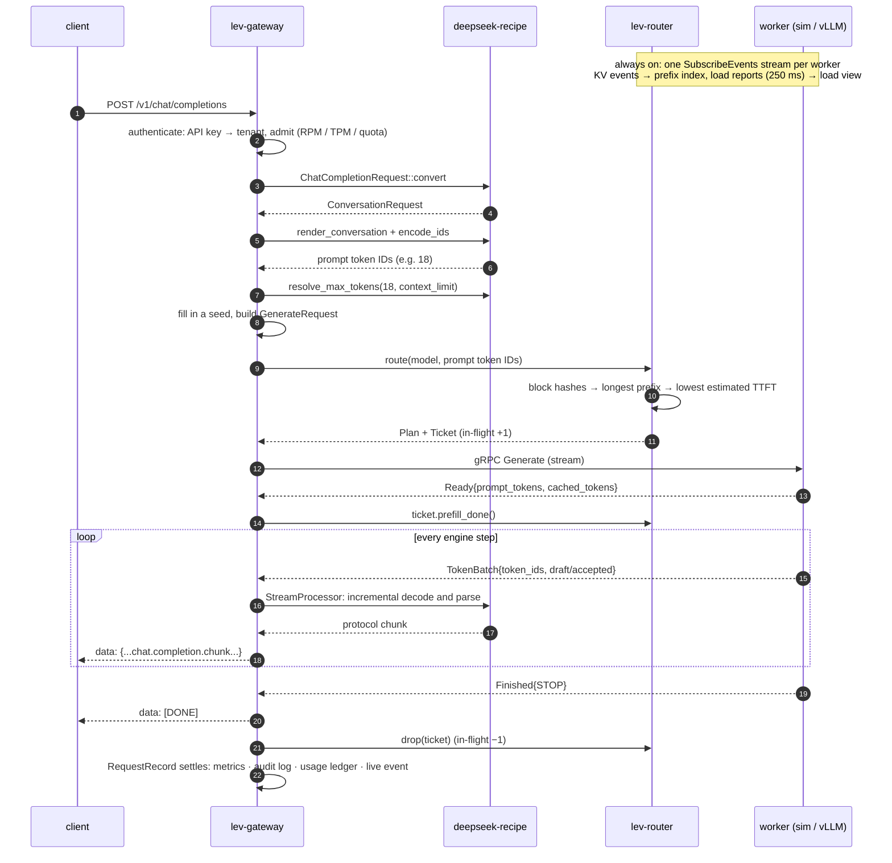

# Illustrated 01: The life of a request

> Code: `crates/lev-gateway/src/pipeline.rs`; protocol: `proto/leviathan/worker/v1/worker.proto`
> Next: [02 How deepseek-recipe turns a request into tokens](02-recipe-protocol.md)

This chapter follows one request all the way through:

```sh
curl localhost:8080/v1/chat/completions -H 'content-type: application/json' -d '{
  "model": "deepseek-flash",
  "messages": [{"role": "user", "content": "What is the weather in Beijing today?"}],
  "stream": true
}'
```

## The whole trip



## What each step produces

| # | Step | Output | On failure |
| --- | --- | --- | --- |
| 1 | authenticate and admit | tenant; RPM token taken, TPM and monthly quota checked | 401 / 403, or 429 with `Retry-After` |
| 2 | parse the envelope | `model`, session key (`x-session-id` / `prompt_cache_key` / `user`) | 400 `invalid_json` |
| 3 | resolve the model | `ServedModel` (tokenizer, encoding, context limit) | 404 `model_not_found`, in the protocol's error format |
| 4 | recipe conversion | `ConversationRequest` | 400 with recipe's message |
| 5 | render + tokenize | prompt token IDs | 400 `unsupported_feature` for images (not enabled yet) |
| 6 | `resolve_max_tokens` | the `max_tokens` to send | 400 `context_length_exceeded`, nothing dispatched |
| 7 | route | `RouteDecision`: unified or prefill + decode, with every candidate's score | 503 `no_available_worker` |
| 8 | dispatch | the worker's `Ready`: prefill done, cache hits confirmed | retried on another worker, up to 3 attempts (below) |
| 9 | stream and parse | each `TokenBatch` becomes protocol chunks | an SSE error frame in the protocol's format |
| 10 | settle | Prometheus metrics, audit entry (replayable), usage ledger, live event | a client that disconnects is recorded as `cancelled` |

## Two boundaries that matter

### Boundary 1: retry before `Ready`, never after

```
            retryable                              │            not retryable
route → Generate → (worker queue) → prefill → Ready → TokenBatch → TokenBatch → … → Finished
                                            │
                   the client has no bytes yet  │  the client already has output
```

When a worker fails before `Ready` (unreachable, timed out, prefill error), the gateway adds it to `exclude` and routes again; the client never notices. The test `failover_skips_a_dead_worker` runs one dead and one healthy worker and all 4 requests succeed. After `Ready`, output already sent cannot be taken back, so the gateway appends an error frame in the protocol's own format:

| Protocol | Error after streaming started |
| --- | --- |
| Chat Completions | `data: {"error": {"message", "type", "code"}}` |
| Responses | `event: error` + `{"type": "error", "code", "message"}` |
| Messages | `event: error` + `{"type": "error", "error": {"type", "message"}}` |

### Boundary 2: who holds the load

A `Ticket` charges the request's load to the chosen worker from the moment it is routed until the stream ends; a client disconnect drops the stream and the ticket with it. The router therefore always sees requests that were dispatched but are not yet in a worker's report (see [04](04-cache-aware-routing.md)).

## The extra leg of a disaggregated request

```mermaid
sequenceDiagram
    participant G as gateway
    participant P as prefill worker
    participant D as decode worker
    G->>P: Generate(stage=PREFILL)
    P-->>G: Ready{kv_transfer: handle}
    P-->>G: Finished
    G->>D: Generate(stage=DECODE, kv_transfer=handle)
    D->>P: pull the KV (sim: bandwidth model; vLLM: NIXL)
    D-->>G: Ready{cached_tokens = transferred tokens}
    D-->>G: TokenBatch …
```

The `cached_tokens` reported to the client are the **prefill worker's** hits: KV that the decode worker received by transfer saved no prefill. (Test: `disaggregated_requests_hand_kv_to_decode`.) Details and measurements: [05](05-pd-disaggregation.md).

## What a request leaves behind

Each audit entry (`GET /admin/requests`) records:

| Field | Meaning |
| --- | --- |
| `request_id` / `response_id` | gateway ID (UUIDv7) / the ID clients see (`chatcmpl-…`, `resp_…`, `msg_…`) |
| `policy` / `plan` / `worker_id` / `prefill_worker_id` / `attempts` | the routing decision, where it ran, retries |
| `prompt_tokens` / `cached_tokens` / `completion_tokens` | usage, also written to the tenant's ledger |
| `seed` | the sampling seed the gateway filled in |
| `ttft_ms` / `tpot_ms` / `e2e_ms` | time to first token, time per output token, end to end, measured at the gateway |
| `spec_draft_tokens` / `spec_accepted_tokens` | DSpark speculative decoding |
| `timeline` | where the time went, stage by stage |
| `outcome` / `finish_reason` / `error` | `ok` · `error` · `rejected` · `cancelled` |

A real timeline, one disaggregated request on the 2P+2D sim cluster (1728-token prompt, 1664 cached):

```
auth            start   0.00 ms  dur   0.00 ms
parse           start   0.00 ms  dur   0.03 ms
convert         start   0.04 ms  dur   0.01 ms
render          start   0.04 ms  dur   0.01 ms
tokenize        start   0.05 ms  dur   2.06 ms
dispatch        start   2.12 ms  dur  62.31 ms   ← route + prefill worker + KV hand-off + decode worker Ready
worker.queue    start   5.43 ms  dur  14.52 ms
worker.prefill  start  19.95 ms  dur  44.49 ms
decode          start  64.51 ms  dur 646.71 ms   ← 128 output tokens
respond         start 711.21 ms  dur   0.49 ms
```

The gateway's own work (everything before `dispatch`) is about 2 ms, almost all of it tokenization. The worker and the model dominate. This is also how the routing bug in [04](04-cache-aware-routing.md) was found.

The entry also keeps the worker's **exact inputs** (prompt token IDs, sampling parameters, seed, constraint), so `POST /admin/requests/{id}/replay` re-runs it and compares the two outputs token by token (test `replay_reproduces_the_output`).

## Why it is built this way

- **Why is dispatch only successful once `Ready` arrives?** It is the last moment at which the client has received nothing. Failures before it can be retried transparently, and failures after it must be reported. Putting the boundary there makes retries safe: no output is ever duplicated.
- **Why is load accounting a ticket released on drop?** Rust ownership guarantees every exit path releases it: normal completion, worker error, client disconnect, timeout.
- **Why does every request get a seed?** Without one there is nothing to replay. Replay is how you investigate "same input, different output" (batch invariance, deterministic sampling), the problem DeepInfer's batch-invariant inference targets.
