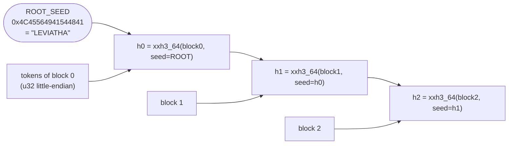
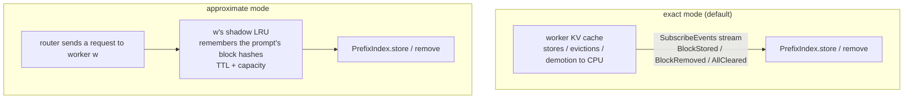

# Illustrated 03: Block hashes and the prefix index: how the router knows who has a prompt cached

> Code: `crates/lev-router/src/hashing.rs`, `crates/lev-router/src/index.rs`, `worker/leviathan_worker/hashing.py`
> Previous: [02 deepseek-recipe](02-recipe-protocol.md) · Next: [04 Cache-aware routing](04-cache-aware-routing.md)

## The problem

DeepInfer's README states that the open release does not include "a KV cache system" or "load balancing across data-parallel replicas". The two go together: if the same prompt prefix (say, an agent's system prompt of a few thousand tokens) keeps landing on the replica that **already caches it**, most of the prefill is skipped and time to first token drops by an order of magnitude.

That requires the router to answer:

```
prompt token IDs of this request ──► how many leading tokens does each worker already cache?
```

## Step 1: cut tokens into blocks

Engines manage the KV cache in **blocks** (pages in vLLM), and prefix caching works at that granularity. Only **full blocks** are cached and shared; a trailing partial block is not.

```
prompt tokens: [ t0 t1 t2 t3 | t4 t5 t6 t7 | t8 t9 t10 t11 | t12 t13 ]
                 block 0        block 1        block 2         partial, ignored
```

## Step 2: chained hashes, one hash for the whole prefix

Each block's hash is seeded with **the previous block's hash**:



An equal `h2` therefore means blocks 0, 1 **and** 2 are all equal. The index only needs "hash → who has it", never the tokens themselves.

**Real data** (block size 4; two users share one system prompt; output of `worker/leviathan_worker/hashing.py`):

| Request | First 8 tokens (system prompt) | Last 6 tokens (their own question) | Block hashes |
| --- | --- | --- | --- |
| alice | `0 128799 100 101 102 103 104 105` | `128803 200 201 202 128804 128822` | `91ed0a7eb296aac5` · `90b95e4dae654d52` · `518d3bee13bf8ca9` |
| bob | same | `128803 300 301 302 128804 128822` | `91ed0a7eb296aac5` · `90b95e4dae654d52` · `25e67fe847cc0fe1` |

The first two blocks (the system prompt) hash identically and the chains split at the third block, which is exactly where the reusable prefix ends.

### Cross-language agreement

The router is Rust and the workers are Python; both must compute **bit-identical** hashes, or KV events would not line up. The convention is written in the header of `proto/leviathan/worker/v1/worker.proto`, and both test suites assert the same vector:

```
tokens = 0..10, block_size = 4
Rust   crates/lev-router/src/hashing.rs   CROSS_LANGUAGE_VECTOR = [0x05CAF1E6F5C06121, 0x075FF973CE997C6B]
Python worker/tests/test_hashing.py        CROSS_LANGUAGE_VECTOR = [0x05CAF1E6F5C06121, 0x075FF973CE997C6B]
```

vLLM uses its own (salted) block hashes, so the vLLM worker **translates** vLLM's native KV events into this convention before publishing them ([07](07-vllm-on-h200.md)). The router only ever sees one kind of hash.

## Step 3: the index

```
PrefixIndex.entries : HashMap<u64 block hash, Entry>

               ┌─────────────────────────── Entry ───────────────────────────┐
  91ed0a7e… ──►│ gpu: 0b0110 (in GPU memory of slots 1, 2)   cpu: 0b1000 (in host memory of slot 3) │
  90b95e4d… ──►│ gpu: 0b0010                                   cpu: 0b0000                         │
  518d3bee… ──►│ gpu: 0b0010                                   cpu: 0b0000                         │
               └─────────────────────────────────────────────────────────────┘
```

- Each worker has a **slot** (0..127), so a set of workers is a `u128` bitmask and an intersection is a single `&`.
- GPU and CPU tiers are kept apart: a CPU-tier block is a hit, but it must be loaded back first, so it costs more (`cpu_hit_cost_ratio` in [04](04-cache-aware-routing.md)).
- Slots carry a **generation**, so a ticket from a removed worker cannot touch a new worker that reuses its slot (test `stale_tickets_do_not_touch_a_reused_slot`).

## Step 4: longest prefix match

Walk from the first block; `alive` is the set of workers that have had every block so far:

```
request blocks:  h0          h1          h2          h3
entry.any:       0b0111      0b0011      0b0010      0b0000
alive:           0b0111  &→  0b0011  &→  0b0010  &→  0b0000 (stop)

result: slot0 matches 1 block · slot1 matches 3 blocks · slot2 matches 2 blocks
```

A gap ends the match: a slot holding h0 and h2 but not h1 matches 1 block (test `longest_prefix_stops_at_first_gap`), just like an engine's prefix cache, which also matches contiguously from the start.

## Step 5: two sources for the index



| | Exact | Approximate |
| --- | --- | --- |
| Source | the worker's KV events: the cache as it really is | the router's own dispatch history: an educated guess |
| Sees evictions | yes (`BlockRemoved`) | no; TTL and capacity are estimates |
| Used for | sim, vLLM (with `--kv-events-config`) | backends without events (DeepInfer); the control group in benchmarks |
| Implementation | bitmask set/clear | per worker `HashMap<hash, (generation, time)>` plus a lazily cleaned queue, amortized O(1) |

The lazy queue: when the same hash is touched again, the old queue entry keeps its old generation and is simply skipped when it reaches the front, so nothing is ever deleted from the middle of the queue.

## Step 6: consistency, or what happens when events are lost

- **Unhealthy means forgotten**: when a worker becomes unhealthy, `set_healthy(false)` clears all its blocks from the index; it may have restarted with an empty cache.
- **Reconnect with a snapshot**: the router resubscribes with `snapshot=true`. The worker first sends `AllCleared`, then replays every cached block as `BlockStored` chains, parents first, so the index converges at once.
- **Gaps are detected**: `KvEventBatch.seq` increases strictly per subscription; a gap or any end of the stream makes the gateway resubscribe for a fresh snapshot. A subscriber that falls behind is closed (`RESOURCE_EXHAUSTED`) rather than skipped, so a gap never goes unnoticed.

## Verification

```sh
cargo test -p lev-router      # 29 tests; index_matches_naive_model is a proptest that
                              # compares the index with a naive set model after random
                              # store / remove / clear sequences
```

## Why it is built this way

- **Why chain the hashes instead of hashing each block alone?** A standalone hash only says "this block's content appeared somewhere", not "and everything before it matches". A chained hash makes one u64 stand for the whole prefix, so matching is a table lookup per block.
- **Why bitmasks for worker sets?** Every block of a match intersects sets; a bitmask intersection is one instruction, and 128 slots is plenty for one router's replicas.
- **Why keep approximate mode?** For backends without KV events, and as a baseline that measures what an exact cache view is worth.
