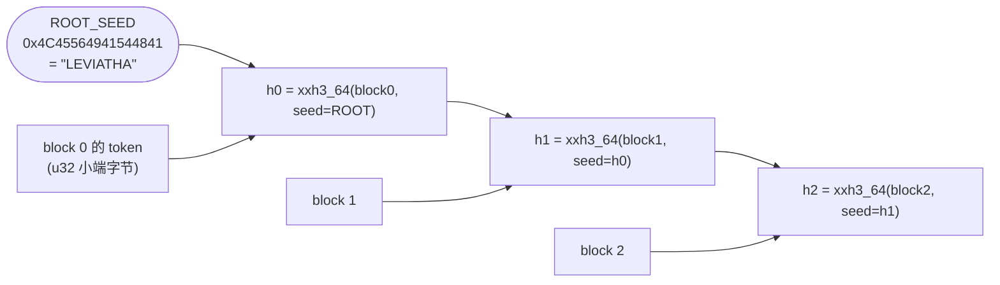
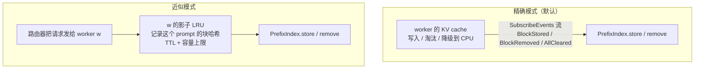

# 图解 03：块哈希与前缀索引 —— 路由器怎么知道“谁缓存了这段 prompt”

> 对应代码：`crates/lev-router/src/hashing.rs`、`crates/lev-router/src/index.rs`、`worker/leviathan_worker/hashing.py`
> 上一篇：[02 deepseek-recipe 把请求变成 token](02-recipe-protocol.md) · 下一篇：[04 cache-aware 路由](04-cache-aware-routing.md)

## 要解决的问题

DeepInfer 的 README 明确说，开源版不包含 “KV cache 系统” 和 “DP 副本间负载均衡”。两者缺一不可：同一段 prompt 前缀（比如 agent 的几千 token 系统提示）如果总是落到**已经缓存了它**的副本上，prefill 就能省掉大部分计算，TTFT 直接下降一个数量级。

前提是路由器能回答这个问题：

```
这个请求的 prompt token 序列 ──► 每个 worker 已经缓存了它的前多少个 token？
```

## 第一步：把 token 切成块

推理引擎按**块**（block，vLLM 叫 page）管理 KV cache，前缀缓存的粒度也是块。只有**完整的块**才会被缓存和共享，最后不满一块的尾巴不算。

```
prompt token:  [ t0 t1 t2 t3 | t4 t5 t6 t7 | t8 t9 t10 t11 | t12 t13 ]
                 block 0        block 1        block 2         不满一块，不参与
```

## 第二步：链式哈希 —— 一个哈希代表“整段前缀”

每个块的哈希都用**上一个块的哈希做种子**：



所以 `h2` 相同，意味着 block 0、1、2 **全部**相同。这样索引里只需存“哈希 → 谁有”，不用存 token 本身。

**真实数据**（块大小 4，两个用户共享同一段系统提示，`worker/leviathan_worker/hashing.py` 实际运行结果）：

| 请求 | 前 8 个 token（系统提示） | 后 6 个 token（各自的问题） | 块哈希 |
| --- | --- | --- | --- |
| alice | `0 128799 100 101 102 103 104 105` | `128803 200 201 202 128804 128822` | `91ed0a7eb296aac5` · `90b95e4dae654d52` · `518d3bee13bf8ca9` |
| bob | 同上 | `128803 300 301 302 128804 128822` | `91ed0a7eb296aac5` · `90b95e4dae654d52` · `25e67fe847cc0fe1` |

前两块（系统提示）哈希完全相同，第三块开始分叉，正好是可复用前缀的边界。

### 跨语言一致性

路由器是 Rust，worker 是 Python，两边必须算出**逐位相同**的哈希，否则 KV 事件对不上。约定写在 `proto/leviathan/worker/v1/worker.proto` 文件头，两边各有一个测试断言同一组向量：

```
tokens = 0..10, block_size = 4
Rust   crates/lev-router/src/hashing.rs   CROSS_LANGUAGE_VECTOR = [0x05CAF1E6F5C06121, 0x075FF973CE997C6B]
Python worker/tests/test_hashing.py        CROSS_LANGUAGE_VECTOR = [0x05CAF1E6F5C06121, 0x075FF973CE997C6B]
```

vLLM 内部用的是自己的块哈希，所以 vLLM 后端的 worker 会把 vLLM 原生的 KV 事件（事件里带 token IDs）**翻译**成这套约定再发出去。路由器永远只认一种哈希。

## 第三步：索引的数据结构

```
PrefixIndex.entries : HashMap<u64 块哈希, Entry>

               ┌──────────────────────── Entry ────────────────────────┐
  91ed0a7e… ──►│ gpu: 0b0110  (slot 1、2 的显存里有)  cpu: 0b1000 (slot 3 的内存里有) │
  90b95e4d… ──►│ gpu: 0b0010                           cpu: 0b0000                 │
  518d3bee… ──►│ gpu: 0b0010                           cpu: 0b0000                 │
               └────────────────────────────────────────────────────────────────┘
```

- 每个 worker 占一个 **slot**（0..127），集合就是一个 `u128` 位图，求交集只要一次 `&`。
- 显存（GPU）和内存（CPU tier）分开记：CPU 上的块也算命中，但要先搬回显存，成本更高（见 04 篇的 `cpu_hit_cost_ratio`）。
- slot 被复用时带 **generation**，旧请求的 Ticket 不会误改新 worker 的计数（`stale_tickets_do_not_touch_a_reused_slot` 测试）。

## 第四步：最长前缀匹配

从第一块开始往后走，`alive` 是“到目前为止每块都有”的 worker 集合：

```
请求块哈希:   h0          h1          h2          h3
entry.any:  0b0111      0b0011      0b0010      0b0000
alive:      0b0111  &→  0b0011  &→  0b0010  &→  0b0000（结束）

结果: slot0 命中 1 块 · slot1 命中 3 块 · slot2 命中 2 块
```

注意中间断了就停：slot 有 h0、h2 但没有 h1 时，只算 1 块（`longest_prefix_stops_at_first_gap` 测试）。引擎的前缀缓存也是这样从头连续匹配的。

## 第五步：索引的两种数据来源



| | 精确模式 | 近似模式 |
| --- | --- | --- |
| 数据来源 | worker 上报的 KV 事件，即缓存的真实状态 | 路由器自己的派发历史，相当于“猜” |
| 能感知淘汰 | 能（`BlockRemoved`） | 不能，只能靠 TTL 和容量估计 |
| 适用 | sim、vLLM（开启 `--kv-events-config`） | 不发事件的后端；也是 benchmark 的对照组 |
| 实现 | 位图增删 | 每个 worker 一个 `HashMap<hash, (generation, time)>` + 惰性删除队列，均摊 O(1) |

近似模式的惰性删除：同一个哈希被反复触碰时，队列里会留下旧的 generation，出队时发现 generation 对不上就直接跳过，不用在队列中间删除元素。

## 第六步：一致性 —— 事件丢了怎么办

- **断线即失忆**：worker 一旦不健康，`set_healthy(false)` 会清空它在索引里的所有块，因为它可能重启过，缓存已经没了。
- **重连带快照**：重新订阅时带 `snapshot=true`，worker 先把现存的全部块以 `BlockStored` 链的形式重放一遍，索引立刻收敛。
- **序号检测丢包**：每条订阅的 `KvEventBatch.seq` 严格递增，网关发现跳号就重新订阅并要快照。

## 验证

```sh
cargo test -p lev-router      # 29 个测试，其中 index_matches_naive_model 是 proptest：
                              # 随机 store/remove/clear 序列后，索引结果和朴素集合模型逐一比对
```

## 为什么这样设计

- **为什么用链式哈希，而不是给每个块单独哈希？** 单独哈希只能说明“这块内容出现过”，说明不了“前面的内容也一样”。链式哈希让一个 u64 就代表整段前缀，匹配时只需要逐块查表。
- **为什么用位图存 worker 集合？** 匹配时每块都要求交集，位图交集是一条指令；128 个 slot 对单个路由器管理的副本数绰绰有余。
- **为什么还保留近似模式？** 一是兼容不发 KV 事件的后端；二是 benchmark 需要一个对照组，用来量化“精确的缓存视图”到底值多少。
