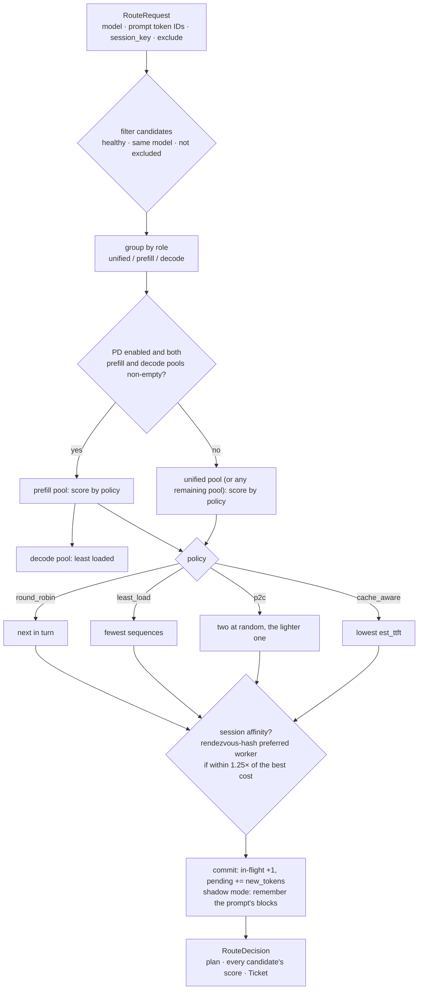
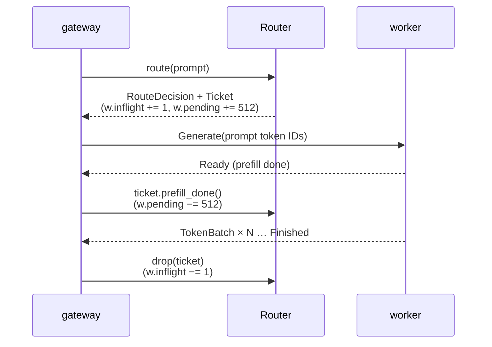

# Illustrated 04: Cache-aware routing = minimizing estimated TTFT

> Code: `crates/lev-router/src/lib.rs` (`Router::route`, `score_candidates`, `choose`, `Ticket`)
> Real data: `cargo run -p lev-router --example explain`, and `lev-bench` against the sim cluster
> Previous: [03 Block hashes and the prefix index](03-prefix-index.md) · Next: [05 PD disaggregation](05-pd-disaggregation.md)

## In one sentence

Cache hits and load balance pull in opposite directions: chase hits blindly and a hot prefix overloads one replica; spread load blindly and the cache is wasted. Instead of tuning two weights, Leviathan converts both into **one unit, the estimated time to first token (TTFT)**, and picks the smallest.

## The cost

For every candidate worker `w`:

```
new_tokens(w) = prompt_len − cached_tokens(w) + cpu_cached_tokens(w) × cpu_hit_cost_ratio
us_per_token  = prefill cost of one uncached token (a constant calibrated per model and hardware, default 30 µs)

est_ttft(w) =  ( pending_prefill_tokens(w) + new_tokens(w) ) × us_per_token     ← prefill queued ahead of us + our own
            +  decode_interference_us × sequences(w)                             ← running sequences slow every step

if w's KV usage > 95%: est_ttft × 4                                              ← nearly full: admission means evictions or queueing
```

- `cached_tokens` comes from the prefix index ([03](03-prefix-index.md)).
- `pending_prefill_tokens` is **the router's own ledger**: uncached prompt tokens of requests dispatched to `w` that have not reached `Ready`. It is fresher than the workers' periodic reports, so a burst of simultaneous requests does not all land on the same "best" replica.
- `sequences = max(the worker's reported running + waiting, the router's in-flight count)`: whichever is fresher and larger.

## A worked example: where cache stops paying for load

All requests share a 4096-token agent system prompt plus a 512-token question (4608 tokens). worker-b caches the system prompt; prefill costs 25 µs/token; `decode_interference_us = 2000`.

| Scenario | worker-a (no cache) | worker-b (4096 cached) | Choice |
| --- | --- | --- | --- |
| 1. both idle | 4608×25 = **115.2 ms** | 512×25 = **12.8 ms** | **b**, saves 89% of the prefill |
| 2. b runs 24 sequences | 115.2 ms | 12.8 + 2×24 = **60.8 ms** | **b**, still worth it |
| 3. b runs 80 sequences | 115.2 ms | 12.8 + 2×80 = **172.8 ms** | **a**, queueing now costs more than the cache saves |

(Actual output of `cargo run -p lev-router --example explain`.)

The break-even is `(115.2 − 12.8) / 2 ≈ 51` sequences: beyond that, the router sends the prefix to the uncached replica, which then caches it too. Hot prefixes replicate themselves to a second replica without any separate replication policy.

## A bug found with data: observed throughput is not capacity

The first version priced a token with each worker's **reported prefill throughput** (`prefill_tokens_per_s`). On an 8-replica sim cluster (96 agents, 800 KV blocks per replica, 32 concurrent requests; `scripts/dev.sh unified 8` + `lev-bench`), cache_aware had a *worse* p99 than round robin:

| Version | Policy | TTFT p50 | TTFT p99 | Hit rate | Requests per replica |
| --- | --- | --- | --- | --- | --- |
| v1 | round_robin | 48.4 ms | 253.8 ms | 48.7% | even |
| v1 | cache_aware | 35.8 ms | **304.0 ms** | 73.3% | **149 / 117 / … / 7** (heavily skewed) |

The per-request stage timeline in the audit log ([01](01-request-lifecycle.md)) pointed at the cause. The slowest requests were all piled on two hot replicas (sim-5, sim-1), with `worker.queue` around 57 ms and `worker.prefill` around 220 ms. Digging further: the hot replicas served mostly **cache hits**, so they computed few prefill tokens and reported a *low* prefill throughput. The router read that as "this replica prefills slowly" and its scores went wrong. **Observed throughput depends on the mix of work; it is not capacity.**

The fix prices prefill with a calibrated per-token constant (`prefill_us_per_token`) and keeps observed throughput for display only. The same benchmark afterwards:

| Version | Policy | TTFT p50 | TTFT p90 | TTFT p99 | E2E p50 | Output tok/s | Hit rate |
| --- | --- | --- | --- | --- | --- | --- | --- |
| v2 | round_robin | 43.8 ms | 85.5 ms | 248.1 ms | 371.8 ms | 3901 | 49.1% |
| v2 | least_load | 81.9 ms | 192.4 ms | 295.0 ms | 397.2 ms | 3658 | 47.2% |
| v2 | p2c | 75.4 ms | 151.1 ms | 295.9 ms | 384.5 ms | 3776 | 46.8% |
| v2 | **cache_aware** | **33.6 ms** | **82.5 ms** | **243.2 ms** | **310.5 ms** | **4517** | **73.5%** |

cache_aware now wins every column: 24 points more hits, 16% more throughput, and the p99 is no longer worse. Requests per replica range from 50 to 76 (coefficient of variation 0.16) instead of 149 vs 7.

> Reading the table: TTFT is **bimodal**, about 32 ms for a hit and 82 ms for a miss. The other three policies all sit near a 50% hit rate, so their p50 falls on one peak or the other depending on whether the hit rate is slightly above or below half; that statistical effect, not worse scheduling, is most of why least_load and p2c show a higher p50 than round robin. Compared fairly, hits have a p50 of 32 to 37 ms under every policy; the difference is the hit rate.

> These are **sim backend** numbers, and the timing parameters are still a placeholder awaiting H200 calibration (`worker/leviathan_worker/profiles/h200-vllm.json` says so in its `source` field). The relative comparison is meaningful; absolute values wait for H200 + vLLM.

## When it does not matter

With a small working set, every policy ends up the same. On 2 prefill workers with 1.28 M tokens of KV each and only 8 agent prompts, every replica soon caches every prompt and all four policies reach 86 to 88% hits. Cache-aware routing pays off when the working set exceeds what one replica can hold (many tenants or agents), when there are many replicas (each cold prefix costs one miss per replica under round robin), and for multi-turn sessions (on 2 prefill workers it lifted the hit rate from 67-73% to 80.6%).

## The whole of `route()`



## Tickets make load visible before the next report



- When a client disconnects, the SSE stream is dropped and the ticket with it: no leaked load.
- If the worker's slot is reused by a new worker, the old ticket's generation no longer matches and it leaves the new worker's counts alone.

## Where each policy loses

| Policy | Strength | Where it loses |
| --- | --- | --- |
| round_robin | simple, perfectly even request counts | ignores the cache; uneven when requests differ in size |
| least_load | good with bursts | ignores the cache: shared prefixes are prefilled on every replica |
| p2c | O(1), common in large fleets | same as least_load |
| cache_aware | hits and load traded in one unit (TTFT) | depends on an accurate cache view, hence the exact vs approximate experiments |

P6 compares the four on H200 together with vLLM's own `vllm-router`.

## Why it is built this way

- **Why measure in time instead of "hit rate − λ·load"?** λ has no physical meaning and needs re-tuning for every workload and machine. Time can be measured and calibrated (a prefill sweep gives the per-token cost), which is why the break-even above can be computed and explained.
- **Why a calibrated constant rather than live throughput?** See the bug above: live throughput says how much was just computed, not how much could be. A replica with a high hit rate looks "slow" and skews the scores.
- **Why does the router keep its own pending ledger?** Reports arrive every 250 ms. Requests arriving within one interval would all see the same stale view and stampede onto the same "best" replica.
- **Why route the decode pool by load only?** Under disaggregation the decode worker receives the KV from the prefill worker; decode-side cache hits do not save prefill. Decode cares about batch size, i.e. TPOT.
