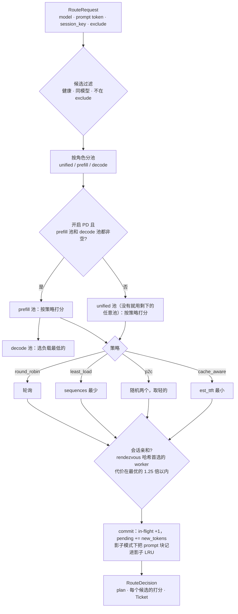
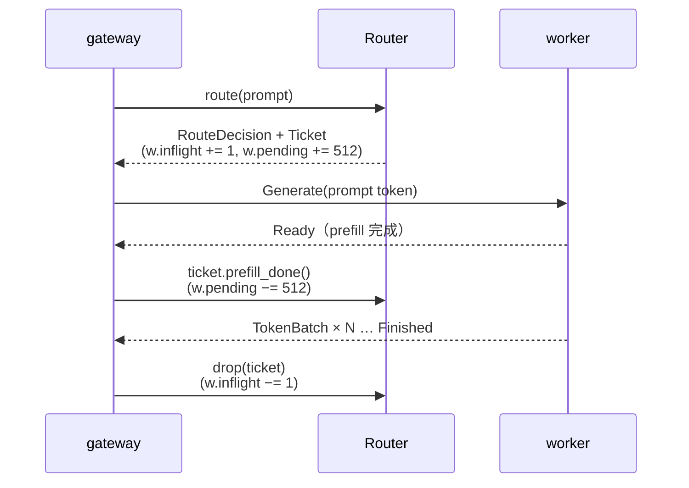

# 图解 04：cache-aware 路由 = 最小化预计 TTFT

> 对应代码：`crates/lev-router/src/lib.rs`（`Router::route`、`score_candidates`、`choose`、`Ticket`）
> 真实数据：`cargo run -p lev-router --example explain`
> 上一篇：[03 块哈希与前缀索引](03-prefix-index.md) · 下一篇：[05 PD 分离](05-pd-disaggregation.md)

## 一句话

缓存命中和负载均衡是互相冲突的两个目标：一味追命中，热门前缀会把一个副本压垮；一味平均分配，缓存就白存了。Leviathan 不调两个权重，而是把两者换算成**同一个单位：预计的首 token 时间（TTFT）**，然后选最小的那个。

## 打分公式

对每个候选 worker `w`：

```
new_tokens(w)   = prompt_len − cached_tokens(w) + cpu_cached_tokens(w) × cpu_hit_cost_ratio
us_per_token    = 每个未命中 token 的 prefill 成本（按模型和硬件标定的常数，默认 30µs）

est_ttft(w) =  ( pending_prefill_tokens(w) + new_tokens(w) ) × us_per_token      ← 排在前面的 + 我自己的 prefill
            +  decode_interference_us × sequences(w)                              ← 正在跑的序列拖慢调度

若 w 的 KV 使用率 > 95%：est_ttft × 4                                              ← 快满了，再塞就要淘汰或排队
```

- `cached_tokens` 来自 03 篇的前缀索引。
- `pending_prefill_tokens` 是**路由器自己记的账**：已派发、还没收到 `Ready` 的请求剩余要 prefill 的 token。它比 worker 的周期性上报更新得快，所以同一瞬间涌入的一批请求不会扎堆到同一个副本。
- `sequences = max(worker 上报的 running + waiting, 路由器记的 in-flight)`，两边取较新、较大的那个。

## 真实例子：缓存 vs 负载的拐点

场景：所有请求共享 4096 token 的 agent 系统提示，用户问题 512 token，prompt 共 4608 token。worker-b 已缓存系统提示，prefill 成本取 25µs/token，`decode_interference_us = 2000`。

| 场景 | worker-a（无缓存） | worker-b（缓存 4096） | 选择 |
| --- | --- | --- | --- |
| 1. 都空闲 | 4608×25 = **115.2 ms** | 512×25 = **12.8 ms** | **b**，省掉 89% 的 prefill |
| 2. b 正在跑 24 条序列 | 115.2 ms | 12.8 + 2×24 = **60.8 ms** | **b**，仍然划算 |
| 3. b 正在跑 80 条序列 | 115.2 ms | 12.8 + 2×80 = **172.8 ms** | **a**，排队代价超过了缓存收益 |

（以上数字是 `cargo run -p lev-router --example explain` 的实际输出。）

拐点在 `(115.2 − 12.8) / 2 ≈ 51` 条序列：b 上跑的序列超过约 51 条时，路由器开始把请求让给没有缓存的 a。随后 a 也会缓存这段系统提示，热门前缀就这样自然地复制到第二个副本，不需要额外设计复制策略。

## 一次用数据找到的 bug：观测吞吐 ≠ 容量

最初的实现用 worker **上报的 prefill 吞吐**（`prefill_tokens_per_s`）来换算每个 token 的成本。在 8 副本 sim 集群上压测（96 个 agent、每副本 800 块 KV、32 并发；`scripts/dev.sh unified 8` + `lev-bench`），cache_aware 的 p99 反而比 round_robin 差：

| 版本 | 策略 | TTFT p50 | TTFT p99 | 命中率 | 各副本请求数 |
| --- | --- | --- | --- | --- | --- |
| v1 | round_robin | 48.4 ms | 253.8 ms | 48.7% | 均匀 |
| v1 | cache_aware | 35.8 ms | **304.0 ms** | 73.3% | **149 / 117 / … / 7**（严重倾斜） |

审计日志里每个请求的阶段时间线（[01 篇](01-request-lifecycle.md)）把原因指了出来：最慢的请求全部堆在 sim-5、sim-1 两个热点副本上，`worker.queue` 约 57ms，`worker.prefill` 约 220ms。再往下追：热点副本处理的大多是**缓存命中**的请求，真正计算的 prefill token 很少，于是它上报的“prefill 吞吐”很低。路由器把这个低值当成了“这台机器 prefill 很慢”，打分随之失真。**观测到的吞吐取决于负载的构成，并不等于容量。**

修正：prefill 成本改用按模型和硬件标定的常数（`prefill_us_per_token`），观测吞吐只用于展示。同一负载重跑：

| 版本 | 策略 | TTFT p50 | TTFT p90 | TTFT p99 | E2E p50 | 输出 tok/s | 命中率 |
| --- | --- | --- | --- | --- | --- | --- | --- |
| v2 | round_robin | 43.8 ms | 85.5 ms | 248.1 ms | 371.8 ms | 3901 | 49.1% |
| v2 | least_load | 81.9 ms | 192.4 ms | 295.0 ms | 397.2 ms | 3658 | 47.2% |
| v2 | p2c | 75.4 ms | 151.1 ms | 295.9 ms | 384.5 ms | 3776 | 46.8% |
| v2 | **cache_aware** | **33.6 ms** | **82.5 ms** | **243.2 ms** | **310.5 ms** | **4517** | **73.5%** |

cache_aware 在所有指标上都最好：命中率高 24 个百分点，吞吐 +16%，p99 也不再变差。各副本的请求数是 50～76（变异系数 0.16），不再倾斜。

> 读这张表要注意：TTFT 是**双峰分布**，命中约 32ms、未命中约 82ms。前三种策略的命中率都在 50% 附近，p50 会落在哪个峰上取决于命中率稍高还是稍低，所以 least_load / p2c 的 p50 比 round_robin 高，主要是这个统计效应，并不是它们的调度更差。看命中 / 未命中各自的分布才公平：四种策略的命中请求 p50 都在 32～37ms，差别全部来自命中率。

> 以上是 **sim 后端**的数字，耗时参数还是待 H200 实测标定的占位值（`worker/leviathan_worker/profiles/h200-vllm.json` 的 `source` 字段写明了这一点）。能下结论的是相对关系，绝对值要等 H200 + vLLM 的数据。

## route() 的完整流程



## Ticket：让负载在下一次上报之前就可见



- 客户端中途断开时，SSE 流被丢弃，Ticket 随之 drop，负载不会泄漏。
- slot 被新 worker 复用时，旧 Ticket 通过 generation 比对发现不匹配，不会改动新 worker 的计数。

## 四种策略各自在哪里输

| 策略 | 优点 | 输在哪里 |
| --- | --- | --- |
| round_robin | 简单，绝对均匀 | 完全无视缓存；请求长短不一时负载也不均 |
| least_load | 对突发流量友好 | 无视缓存，共享前缀会在所有副本上重复 prefill |
| p2c | O(1)，大规模集群常用 | 同上 |
| cache_aware | 命中和负载统一成 TTFT 来权衡 | 依赖缓存视图的准确性，所以才有精确 / 近似两种模式的对比实验 |

P6 的 benchmark 会在同一负载下对比这四种策略和 vLLM 官方的 `vllm-router`。

## 为什么这样设计

- **为什么打分单位是时间，而不是“命中率 − λ·负载”？** λ 没有物理意义，换一个负载或硬件就要重调。时间是可以测量和标定的：prefill 成本可以用 sweep 测出来，所以拐点能像上面那样算出来解释。
- **为什么 prefill 成本用标定常数，不用实时上报的吞吐？** 见上面那个 bug：实时吞吐反映的是“刚才算了多少”，不是“最多能算多少”。缓存命中率高的副本看起来反而“慢”，打分会被带偏。
- **为什么路由器自己记 pending，不全靠 worker 上报？** 上报是周期性的（250ms）。如果只看上报，同一个周期内涌入的几十个请求看到的都是同一份旧状态，会全部扎到同一个“最优”副本上，也就是羊群效应。
- **为什么 decode 池只按负载选？** PD 分离下 decode 侧的 KV 来自 prefill 传输，decode 侧自己的前缀缓存命中不会减少 prefill 计算。影响 decode 的主要是批大小，也就是 TPOT。
