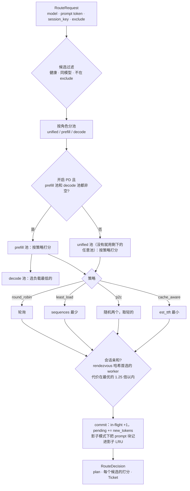
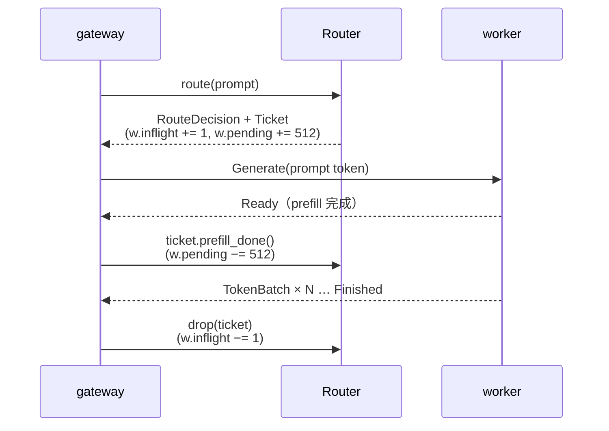

# 图解 04：cache-aware 路由 = 最小化预计 TTFT

> 对应代码：`crates/lev-router/src/lib.rs`（`Router::route`、`score_candidates`、`choose`、`Ticket`）
> 真实数据：`cargo run -p lev-router --example explain`
> 上一篇：[03 块哈希与前缀索引](03-prefix-index.md) · 下一篇：[05 PD 分离](05-pd-disaggregation.md)

## 一句话

缓存命中和负载均衡是互相冲突的两个目标：一味追命中，热门前缀会把一个副本压垮；一味平均分配，缓存就白存了。Leviathan 不调两个权重，而是把两者换算成**同一个单位：预计的首 token 时间（TTFT）**，然后选最小的那个。

## 打分公式

对每个候选 worker `w`：

```
new_tokens(w)   = prompt_len − cached_tokens(w) + cpu_cached_tokens(w) × cpu_hit_cost_ratio
us_per_token(w) = 1e6 / w 上报的 prefill 吞吐        （没上报时用默认值 25µs）

est_ttft(w) =  ( pending_prefill_tokens(w) + new_tokens(w) ) × us_per_token(w)   ← 排在前面的 + 我自己的 prefill
            +  decode_interference_us × sequences(w)                              ← 正在跑的序列拖慢调度

若 w 的 KV 使用率 > 95%：est_ttft × 4                                              ← 快满了，再塞就要淘汰或排队
```

- `cached_tokens` 来自 03 篇的前缀索引。
- `pending_prefill_tokens` 是**路由器自己记的账**：已派发、还没收到 `Ready` 的请求剩余要 prefill 的 token。它比 worker 的周期性上报更新得快，所以同一瞬间涌入的一批请求不会扎堆到同一个副本。
- `sequences = max(worker 上报的 running + waiting, 路由器记的 in-flight)`，两边取较新、较大的那个。

## 真实例子：缓存 vs 负载的拐点

场景：所有请求共享 4096 token 的 agent 系统提示，用户问题 512 token，prompt 共 4608 token。worker-b 已缓存系统提示，两台的 prefill 吞吐都是 40k token/s（25µs/token），`decode_interference_us = 2000`。

| 场景 | worker-a（无缓存） | worker-b（缓存 4096） | 选择 |
| --- | --- | --- | --- |
| 1. 都空闲 | 4608×25 = **115.2 ms** | 512×25 = **12.8 ms** | **b**，省掉 89% 的 prefill |
| 2. b 正在跑 24 条序列 | 115.2 ms | 12.8 + 2×24 = **60.8 ms** | **b**，仍然划算 |
| 3. b 正在跑 80 条序列 | 115.2 ms | 12.8 + 2×80 = **172.8 ms** | **a**，排队代价超过了缓存收益 |

（以上数字是 `cargo run -p lev-router --example explain` 的实际输出。）

拐点在 `(115.2 − 12.8) / 2 ≈ 51` 条序列：b 上跑的序列超过约 51 条时，路由器开始把请求让给没有缓存的 a。随后 a 也会缓存这段系统提示，热门前缀就这样自然地复制到第二个副本，不需要额外设计复制策略。

## route() 的完整流程



## Ticket：让负载在下一次上报之前就可见



- 客户端中途断开时，SSE 流被丢弃，Ticket 随之 drop，负载不会泄漏。
- slot 被新 worker 复用时，旧 Ticket 通过 generation 比对发现不匹配，不会改动新 worker 的计数。

## 四种策略各自在哪里输

| 策略 | 优点 | 输在哪里 |
| --- | --- | --- |
| round_robin | 简单，绝对均匀 | 完全无视缓存；请求长短不一时负载也不均 |
| least_load | 对突发流量友好 | 无视缓存，共享前缀会在所有副本上重复 prefill |
| p2c | O(1)，大规模集群常用 | 同上 |
| cache_aware | 命中和负载统一成 TTFT 来权衡 | 依赖缓存视图的准确性，所以才有精确 / 近似两种模式的对比实验 |

P6 的 benchmark 会在同一负载下对比这四种策略和 vLLM 官方的 `vllm-router`。

## 为什么这样设计

- **为什么打分单位是时间，而不是“命中率 − λ·负载”？** λ 没有物理意义，换一个负载或硬件就要重调。时间是可以测量的：prefill 吞吐由 worker 实时上报，所以同一个公式在 H200 和模拟器上都成立，拐点也能像上面那样算出来解释。
- **为什么路由器自己记 pending，不全靠 worker 上报？** 上报是周期性的（250ms）。如果只看上报，同一个周期内涌入的几十个请求看到的都是同一份旧状态，会全部扎到同一个“最优”副本上，也就是羊群效应。
- **为什么 decode 池只按负载选？** PD 分离下 decode 侧的 KV 来自 prefill 传输，decode 侧自己的前缀缓存命中不会减少 prefill 计算。影响 decode 的主要是批大小，也就是 TPOT。
