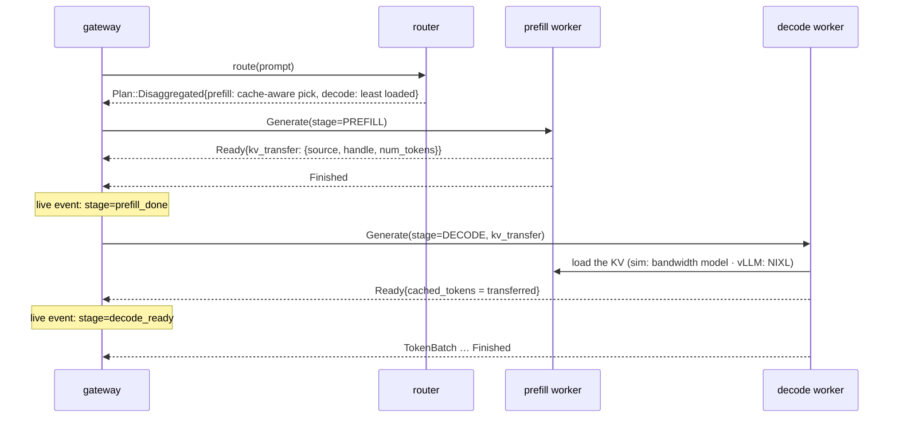

# Illustrated 05: Prefill/decode disaggregation is a trade-off

> Code: `crates/lev-gateway/src/pipeline.rs` (`run_disaggregated`), `crates/lev-router/src/lib.rs` (PD pairing), `worker/leviathan_worker/backends/sim.py` (hand-off)
> Real data: `scripts/dev.sh unified 4` vs `scripts/dev.sh pd 2` + `lev-bench`, results in `bench/results/pd-vs-unified/`
> Previous: [04 Cache-aware routing](04-cache-aware-routing.md) · Next: [06 The simulated engine](06-sim-engine.md)

## What it is

A request has two phases with opposite needs. **Prefill** processes the whole prompt in one pass and is compute-bound. **Decode** produces one token (or a few, with speculation) per step and is memory-bandwidth-bound. On a unified replica both share every engine step, so a long prefill entering the batch stretches the step and every decoding sequence's time per output token (TPOT) with it.

Disaggregation runs them on different replicas: a prefill pool computes the prompt's KV cache, hands it to a decode pool, and the decode pool streams the answer. DeepInfer's README lists "VE/Prefill/Decode disaggregation" among the pieces missing from its open release.

How the pieces fit:

- **Router**: when both pools are healthy, the prefill worker is chosen by the policy (cache-aware: where the prefix already is) and the decode worker by load. If only one pool is up, its workers run requests end to end.
- **Hand-off**: the prefill stage's `Ready` carries a `KvTransfer{source_worker_id, handle, num_tokens}`. The handle is opaque to the gateway: NIXL `kv_transfer_params` for vLLM; for the sim, `{"format": "leviathan-sim-kv/1", "block_hashes", "parents", ...}`, which the decode worker checks against its own prompt hashes (`INVALID_ARGUMENT` on a mismatch).
- **Transfer cost** (sim): `tokens × kv_bytes_per_token / bandwidth`; a 1728-token prompt at 30 KiB/token is 53 MB, about 1 ms at 400 Gb/s. The decode worker only transfers blocks it does not already have.
- **Usage**: the client's `cached_tokens` are the prefill worker's hits. Tokens the decode worker received by transfer saved no prefill.

## Measured: same 4-replica budget, two workloads

Both runs use the `cache_aware` policy, 32 concurrent requests, and the sim backend's placeholder H200 profile ([06](06-sim-engine.md)).

### Workload A: shared agent prompts (24 agents, ~1.7k-token prompts, 128 output tokens)

| Layout | TTFT p50 | TTFT p90 | TTFT p99 | TPOT p50 | TPOT p99 | E2E p50 | Output tok/s | Hit rate |
| --- | --- | --- | --- | --- | --- | --- | --- | --- |
| 4 unified | **34.8 ms** | **85.8 ms** | **423.6 ms** | **5.47 ms** | 7.64 ms | **740 ms** | **5093** | 83.2% |
| 2 prefill + 2 decode | 67.5 ms | 117.7 ms | 634.6 ms | 5.61 ms | **6.71 ms** | 789 ms | 4722 | 84.3% |

### Workload B: long unique prompts (4176 tokens, no reuse, 256 output tokens)

| Layout | TTFT p50 | TTFT p90 | TTFT p99 | TPOT p50 | TPOT p90 | TPOT p99 | E2E p50 | Output tok/s |
| --- | --- | --- | --- | --- | --- | --- | --- | --- |
| 4 unified | **160.7 ms** | **426.2 ms** | **1105.8 ms** | 8.81 ms | 10.57 ms | 12.07 ms | 2403 ms | 3153 |
| 2 prefill + 2 decode | 757.0 ms | 985.7 ms | 2244.5 ms | **5.64 ms** | **6.17 ms** | **6.64 ms** | **2121 ms** | **3337** |

## Reading the numbers

- **Workload A: PD loses.** With 83% of prompt tokens served from cache, little prefill actually runs, so there is little interference to remove. PD still pays for two serial stages, a transfer and half the prefill capacity: TTFT p50 nearly doubles, throughput drops 7%, and the only gain is a steadier TPOT tail (p99 7.64 → 6.71 ms).
- **Workload B: PD wins where it is meant to.** Every request brings 4.2k tokens of fresh prefill. On unified replicas those prefills land in the same steps as decoding sequences, and TPOT p50 is 8.81 ms. Separated, decode runs clean steps: TPOT drops 36% at p50 and 45% at p99, end-to-end latency falls 12% and throughput rises 6%.
- **The price is TTFT.** Half the replicas now do all the prefill, so prefills queue: TTFT p50 goes from 161 to 757 ms. That is the knob. The **P:D ratio** trades TTFT (more prefill replicas) against TPOT and decode capacity (more decode replicas), and the right ratio depends on the prompt/output length mix.

A real timeline of one disaggregated request (1728-token prompt, 1664 tokens cached on the prefill worker) shows where its 64.5 ms TTFT went: 2 ms of gateway work (tokenization), then 62 ms of dispatch, of which 14.5 ms queueing and 44.5 ms prefill plus hand-off. Decode of 128 tokens took 647 ms.

## When to disaggregate

| Use PD when | Stay unified when |
| --- | --- |
| prompts are long and mostly unique (RAG, document QA) | prompts share long prefixes and hit the cache |
| TPOT / streaming smoothness is the SLO | TTFT is the SLO |
| you can tune the P:D ratio to the workload | the fleet is small (2 + 2 halves the prefill capacity) |

> Sim numbers, not H200 measurements. On vLLM, the hand-off is NIXL between two TP4 groups on one 8× H200 node; that layout is not officially verified on H200, so `MODE=pd` in `deploy/slurm/h200.sbatch` is experimental ([07](07-vllm-on-h200.md)).

## Why it is built this way

- **Why let the router pick the two workers independently?** They optimize different things. The prefill worker should hold the prefix (saves compute); the decode worker should have the smallest batch (lower TPOT).
- **Why read the prefill stage's `Finished` before starting decode?** The prefill engine must not see the hand-off as a cancelled request; with vLLM it keeps the KV blocks for the remote decode until they are pulled.
- **Why is the handle opaque?** NIXL parameters, sim block lists and whatever DeepInfer's eventual PD path needs are different shapes. The gateway only forwards them, so adding a backend never changes the gateway.
- **Why keep unified as the default for small fleets?** The measurements above: disaggregation only pays when prefill interference is the bottleneck, and on a 4-replica fleet it halves prefill capacity.
