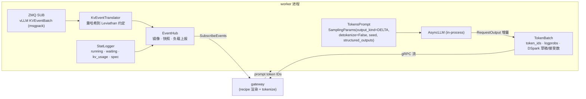

# 图解 07：H200 上的 vLLM —— 换一个引擎，协议不变

> 对应代码：`worker/leviathan_worker/backends/vllm_backend.py`、`deploy/slurm/`
> 测试：`worker/tests/test_vllm_translation.py`（不需要 GPU）
> 实测数据：待 Explorer 集群上的运行（P6）补上

## 为什么是 vLLM

DeepInfer 只支持 SM100 和昇腾 950（证据见 [deepinfer-status.md](../deepinfer-status.md)），Explorer 集群上最好的卡是 H200（SM90）。vLLM ≥ 0.31 官方支持 **同一个模型** DeepSeek-V4.1-Flash 运行在 H200 上，每副本 TP4 + Engram CPU offload，一台 8 卡节点正好放两个副本：

```
┌──────────────────────── Explorer gpu 节点：8× H200 (141 GB) · 512 GB 内存 ────────────────────────┐
│  GPU 0-3  vLLM 副本 0 (TP4)  ◄── worker :50051 ── KV 事件 ZMQ :5557                                 │
│  GPU 4-7  vLLM 副本 1 (TP4)  ◄── worker :50052 ── KV 事件 ZMQ :5558                                 │
│  CPU      lev-gateway :8080 ── cache_aware 路由 ── lev-bench / smoke.py（同节点运行，测得的是纯服务端时延）│
│  内存      两份 Engram 表（pinned，UVA 读取）                                                         │
└──────────────────────────────────────────────────────────────────────────────────────────────────┘
          ▲ ssh -L 8080:<node>:8080 explorer  ← 笔记本上的控制台
```

## worker 对 vLLM 做了什么



要点：

- **不使用 vLLM 的 OpenAI 前端**：prompt 已经由 recipe 渲染、tokenize，worker 只把 token ID 交给 `AsyncLLM`（`detokenize=False`、`skip_special_tokens=False`），输出也是 token ID。vLLM 的 `--tool-call-parser`、`--enable-auto-tool-choice` 这类前端参数不需要，工具调用由网关里的 recipe 解析。
- **引擎参数与 `vllm serve` 完全一致**：`--vllm-args` 交给 vLLM 自己的 `AsyncEngineArgs` 解析器，recipe 里的 H200 参数可以原样照搬（见 `deploy/slurm/common.sh` 的 `lev_vllm_args`）。
- **`reasoning_ended`**：非思考模式下 prompt 以 `</think>` 结尾，结构化输出的语法从第一个 token 开始生效；思考模式下由 `--reasoning-parser deepseek_v41` 等到 `</think>` 之后再生效。
- **工具调用不加语法约束**：DSML 标签必须以特殊 token 的形式生成，recipe 的解析器才认；字符级语法保证不了这一点。模型本身就是按 DSML 训练的，`tool_choice=required` 时 prompt 也已经停在打开的调用块里。

## KV 事件翻译：为什么要重哈希

vLLM 的块哈希带随机盐，路由器在拿到 prompt 时**算不出来**，没法拿来查前缀。好在 vLLM 0.31 的 `BlockStored` 事件里带着这些块的 token IDs：

```
vLLM 事件:   BlockStored{ block_hashes: [v2, v3], parent_block_hash: v1, token_ids: [t16 … t31], block_size: 8 }

翻译器:      parent = map[v1]                       ← 之前翻译过的 v1 对应的 Leviathan 哈希
             ours   = block_hashes(t16…t31, 8, parent)   ← 从父块继续 xxh3 链
             map[v2] = ours[0];  map[v3] = ours[1]

输出:        BlockStored{ block_hashes: [ours0, ours1], parent_hash: map[v1], medium: GPU }
```

- `BlockRemoved{[v3]}` 通过 map 查到 `ours1`，映射关系同时删除；
- 父块不在 map 里（漏了事件）时，记为 orphan，不发出一个无法接到链上的块；
- `AllBlocksCleared` 时清空 map，并原样发出 `AllCleared`。

单元测试 `test_stored_chain_is_rehashed_in_leviathan_convention` 断言：分两次到达的 vLLM 事件，翻译后与一次性计算的 `block_hashes(全部 token)` 完全相等。

### 混合注意力：只看全上下文的那一组

V4.1 每层都有 128 token 的滑动窗口，部分层还有压缩 KV。vLLM 对混合模型按 **KV cache group** 分别发事件（`group_idx`、`kv_cache_spec_kind`、`kv_cache_spec_sliding_window`）。滑动窗口组的块会随窗口滑动不断淘汰，不能代表“这段前缀能不能复用”，所以翻译器只跟踪第一个**非滑动窗口**的组（测试 `test_sliding_window_groups_are_ignored`）。

## DSpark 统计

DSpark 每步起草 5 个 token、并行验证。vLLM 在每个 `CompletionOutput.spec_decode_metrics` 里给出**累计**的草稿数和接受直方图；worker 的 `SpecTracker` 把它差分成每步的 `draft_tokens` / `accepted_tokens`，网关累加进审计记录和 `lev_spec_*_tokens_total`。被丢弃的 EOS 所在那一步的统计也不会丢：这时 worker 发一个 token 为空的 `TokenBatch`。

## PD 分离（实验性）

`MODE=pd` 时两个副本分别是 prefill 和 decode，KV 通过 NIXL 传输：

| 阶段 | worker 发给 vLLM 的 | 返回给网关的 |
| --- | --- | --- |
| prefill | `max_tokens=1`，`extra_args.kv_transfer_params={"do_remote_decode": true}` | `Ready.kv_transfer.handle` = vLLM 返回的 `kv_transfer_params`（JSON） |
| decode | `extra_args.kv_transfer_params` = 上面的 handle 原样传入 | 正常的 token 流 |

vLLM recipe 只在 GB200 上验证过 1P1D，H200 单节点 TP4+TP4 没有官方验证，所以这一项标为实验性。跑不通时，PD 只在 sim 中演示，并在这里写明原因。

## 实测数据（待补）

| 指标 | 值 |
| --- | --- |
| 两个副本就绪耗时 | — |
| 单请求 TTFT / TPOT | — |
| DSpark 接受率 | — |
| 4 种策略在 agent-shared-prefix 负载下的 TTFT p99 | — |

## 为什么这样设计

- **为什么 worker 进程内嵌 AsyncLLM，而不是把请求转发给 `vllm serve`？** 转发的话，token 进、token 出需要 vLLM 的 completions 接口配合 token ID 输入和 `return_tokens_as_token_ids`，还要多一跳 HTTP 和 JSON。进程内调用可以直接拿到 `num_cached_tokens`、`kv_transfer_params`、逐请求的投机解码统计和调度器统计。
- **为什么不直接用 vLLM 的块哈希做路由？** 路由发生在请求到达 worker 之前，路由器手上只有 prompt token。只有可以从 token 重算的哈希才能用来查表；而让 vLLM 改用无盐哈希，又会把哈希碰撞攻击面暴露给多租户环境。翻译层把这个问题限制在 worker 内部解决。
