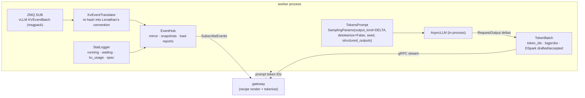

# Illustrated 07: vLLM on H200: another engine, same protocol

> Code: `worker/leviathan_worker/backends/vllm_backend.py`, `deploy/slurm/`
> Tests: `worker/tests/test_vllm_translation.py` (no GPU needed)
> Measured data: pending the Explorer cluster runs (P6)
> Previous: [06 The simulated engine](06-sim-engine.md)

## Why vLLM

DeepInfer supports only SM100 and Ascend 950 (evidence in [deepinfer-status.md](../deepinfer-status.md)), and the best GPUs on the Explorer cluster are H200 (SM90). vLLM ≥ 0.31 officially runs **the same model**, DeepSeek-V4.1-Flash, on H200: four GPUs per replica (TP4) with the Engram tables offloaded to host memory, so one 8-GPU node holds two replicas:

```
┌──────────────────── Explorer gpu node: 8× H200 (141 GB) · 512 GB RAM ────────────────────┐
│  GPU 0-3  vLLM replica 0 (TP4)  ◄── worker :50051 ── KV events ZMQ :5557                  │
│  GPU 4-7  vLLM replica 1 (TP4)  ◄── worker :50052 ── KV events ZMQ :5558                  │
│  CPU      lev-gateway :8080 ── cache_aware routing ── lev-bench / smoke.py on the node    │
│  RAM      two copies of the Engram tables (pinned, read through UVA)                       │
└───────────────────────────────────────────────────────────────────────────────────────────┘
          ▲ ssh -L 8080:<node>:8080 explorer   ← the console on a laptop
```

## What the worker does with vLLM



- **No vLLM chat frontend.** recipe has already rendered and tokenized the prompt; the worker hands token IDs to `AsyncLLM` (`detokenize=False`, `skip_special_tokens=False`) and returns token IDs. Frontend flags such as `--tool-call-parser` and `--enable-auto-tool-choice` are not needed; recipe parses tool calls in the gateway.
- **Engine arguments exactly as for `vllm serve`.** `--vllm-args` goes through vLLM's own `AsyncEngineArgs` parser, so the H200 recipe's flags apply unchanged (`lev_vllm_args` in `deploy/slurm/common.sh`).
- **`reasoning_ended`.** Outside thinking mode the prompt ends in `</think>`, so a structured-output grammar applies from the first token; in thinking mode `--reasoning-parser deepseek_v41` delays it until after `</think>`.
- **No grammar for tool calls.** DSML tags must be produced as special tokens for recipe's parser to recognize them, which a character-level grammar cannot guarantee. The model is trained on DSML, and with `tool_choice=required` the prompt already ends inside the opened call block.

## KV event translation: why re-hash

vLLM's block hashes are salted, so the router, holding only prompt tokens, **cannot compute them** and cannot use them for lookups. vLLM 0.31's `BlockStored` events, however, carry the blocks' token IDs:

```
vLLM event:   BlockStored{ block_hashes: [v2, v3], parent_block_hash: v1, token_ids: [t16 … t31], block_size: 8 }

translator:   parent = map[v1]                            ← the Leviathan hash translated earlier for v1
              ours   = block_hashes(t16…t31, 8, parent)   ← continue the xxh3 chain from the parent
              map[v2] = ours[0];  map[v3] = ours[1]

published:    BlockStored{ block_hashes: [ours0, ours1], parent_hash: map[v1], medium: GPU }
```

- `BlockRemoved{[v3]}` maps to `ours1` through the table, and the mapping is dropped.
- A parent missing from the table (missed events) is counted as an orphan; a block that cannot join a chain is never published.
- `AllBlocksCleared` clears the table and is forwarded as `AllCleared`.

The test `test_stored_chain_is_rehashed_in_leviathan_convention` asserts that vLLM events arriving in two pieces translate to exactly `block_hashes(all tokens)` computed in one go.

### Hybrid attention: follow only the full-context group

V4.1 has a 128-token sliding window in every layer and compressed KV in some. vLLM publishes events per **KV cache group** (`group_idx`, `kv_cache_spec_kind`, `kv_cache_spec_sliding_window`). Sliding-window blocks are evicted as the window moves and say nothing about whether a prefix can be reused, so the translator follows the first group that is **not** sliding-window (test `test_sliding_window_groups_are_ignored`).

## DSpark statistics

DSpark drafts 5 tokens per step and verifies them in parallel. vLLM reports **cumulative** draft counts and an acceptance histogram in each `CompletionOutput.spec_decode_metrics`; the worker's `SpecTracker` turns them into per-step `draft_tokens` / `accepted_tokens`, which the gateway adds to the audit log and `lev_spec_*_tokens_total`. A step whose last token is the dropped EOS still counts: the worker sends a token-less `TokenBatch` with its statistics.

## PD disaggregation (experimental)

With `MODE=pd` one replica prefills and the other decodes, and the KV moves over NIXL:

| Stage | What the worker sends vLLM | What it returns to the gateway |
| --- | --- | --- |
| prefill | `max_tokens=1`, `extra_args.kv_transfer_params={"do_remote_decode": true}` | `Ready.kv_transfer.handle` = vLLM's returned `kv_transfer_params` (JSON) |
| decode | `extra_args.kv_transfer_params` = that handle, unchanged | the usual token stream |

The vLLM recipe verifies 1P1D only on GB200; TP4 + TP4 on one H200 node is not officially verified, hence "experimental". If it does not work, PD stays a sim demonstration ([05](05-pd-disaggregation.md)) and the reason is recorded here.

## Measurements (pending)

| Metric | Value |
| --- | --- |
| time for both replicas to become ready | — |
| single-request TTFT / TPOT | — |
| DSpark acceptance | — |
| TTFT p99 of the four policies on agent-shared-prefix | — |

## Why it is built this way

- **Why embed AsyncLLM in the worker instead of proxying to `vllm serve`?** A proxy would need vLLM's completions endpoint to accept token IDs and return `return_tokens_as_token_ids`, plus an extra HTTP and JSON hop. In-process, the worker gets `num_cached_tokens`, `kv_transfer_params`, per-request speculative statistics and scheduler statistics directly.
- **Why not route on vLLM's own block hashes?** Routing happens before the request reaches any worker, with only prompt tokens in hand; only a hash recomputable from tokens can be looked up. Making vLLM use unsalted hashes instead would expose hash-collision attacks in a multi-tenant deployment. The translation layer keeps the problem inside the worker.
