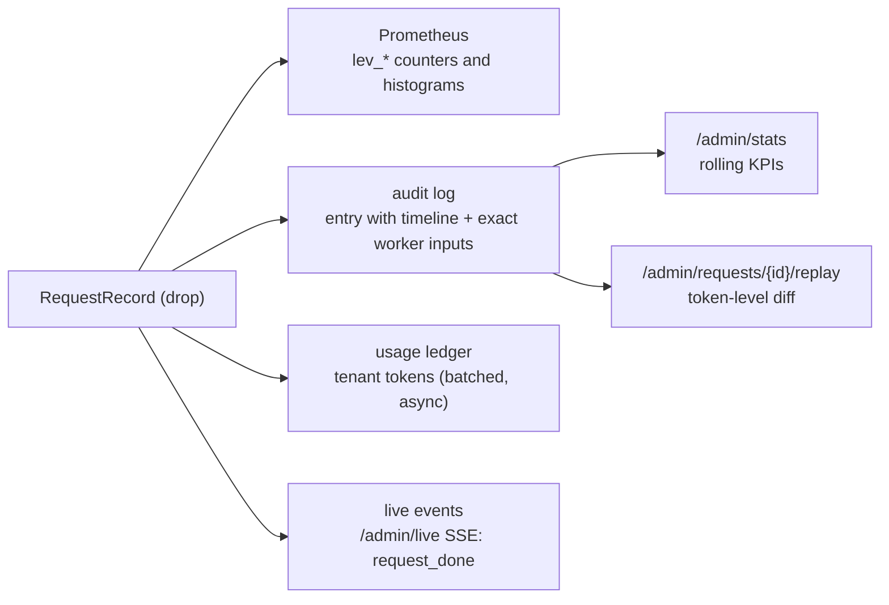

# Illustrated 08: Observability and replay

> Code: `crates/lev-gateway/src/pipeline.rs` (`RequestRecord`, `Stage`), `audit.rs`, `metrics.rs`, `events.rs`, `api.rs` (`/admin/stats`, replay)
> Real data: `scripts/dev.sh unified 4` + 120 agent-shared-prefix requests (`lev-bench --agents 12 --requests 120 --concurrency 12`)
> Previous: [07 vLLM on H200](07-vllm-on-h200.md) · Next: [09 Bursts, Kafka and admission control](09-bursts-and-kafka.md)

## One record per request, four ways to read it

When a request ends (normally, with an error, or because the client hung up), its `RequestRecord` is dropped, and the drop settles everything at once:



Because all four come from the same drop, they cannot disagree. From the run above, Prometheus says:

```
lev_requests_total{protocol="chat_completions",model="DeepSeek-V4.1-Flash",outcome="ok"} 120
lev_prompt_tokens_total{model="DeepSeek-V4.1-Flash",tenant="anonymous"} 206638
lev_cached_tokens_total{model="DeepSeek-V4.1-Flash",tenant="anonymous"} 172288
lev_spec_draft_tokens_total{model="DeepSeek-V4.1-Flash"} 12775
lev_spec_accepted_tokens_total{model="DeepSeek-V4.1-Flash"} 5005
```

and `/admin/stats?window_s=120`, computed from the audit log, says the same:

```json
{
  "window_s": 120, "n": 120, "source": "audit log (requests finished in the window)",
  "outcomes": {"ok": 120},
  "ttft_ms": {"p50": 32.79, "p90": 68.83, "p99": 188.68},
  "tpot_ms": {"p50": 5.38, "p90": 6.36},
  "e2e_ms":  {"p50": 377.78, "p99": 567.29},
  "prompt_tokens": 206638, "cached_tokens": 172288, "cache_hit_rate": 0.834,
  "spec_accept_rate": 0.392,
  "per_worker": {"sim-0": 22, "sim-1": 38, "sim-2": 25, "sim-3": 35},
  "per_policy": {"cache_aware": 120}
}
```

The DSpark acceptance of 39.2% (5005 / 12775) is a useful sanity check: the sim accepts each of 5 drafts with probability 0.72 until the first rejection, whose expected acceptance is about 41% ([06](06-sim-engine.md)).

## The metrics

| Metric | Kind | Labels | What it answers |
| --- | --- | --- | --- |
| `lev_requests_total` | counter | protocol, model, outcome | traffic and error rate |
| `lev_ttft_seconds` / `lev_tpot_seconds` / `lev_e2e_seconds` | histogram | model | the latency SLOs |
| `lev_prompt_tokens_total` / `lev_cached_tokens_total` / `lev_completion_tokens_total` | counter | model, tenant | usage and prefix-cache hit rate |
| `lev_spec_draft_tokens_total` / `lev_spec_accepted_tokens_total` | counter | model | speculative decoding efficiency |
| `lev_route_decisions_total` | counter | policy, plan | which policy and plan (unified / disaggregated) ran |
| `lev_dispatch_retries_total` | counter | | failover activity |
| `lev_throttled_total` | counter | tenant, reason | RPM / TPM / quota rejections |
| `lev_worker_running` / `_waiting` / `_kv_usage` / `_decode_tokens_per_second` / `_spec_accept_rate` | gauge | worker | each replica's last load report |

`dashboards/grafana/leviathan.json` (generated by `scripts/build_dashboard.py`) plots them; docker compose provisions it.

## The timeline: where did the time go

Every audit entry has a `timeline`: stages relative to the request's arrival, measured at the gateway, plus the worker's own account of queueing and prefill from its `Ready`. [01](01-request-lifecycle.md) shows a full example. The timeline is what turned "cache_aware has a worse p99" into "hot replicas queue for 57 ms because the cost model misread their throughput" in [04](04-cache-aware-routing.md): the slow requests' `worker.queue` and `worker.prefill` stages pointed at two replicas, and the per-replica request counts confirmed the skew.

## Replay: same inputs, same tokens?

The audit entry stores the worker's exact inputs: prompt token IDs, sampling parameters including the seed the gateway filled in, the output constraint and hints. `POST /admin/requests/{id}/replay` dispatches them again and compares outputs token by token:

```
identical: true   first_divergence: null   tokens: 64 vs 64   worker: sim-1 → sim-1   seed: 7818663231864555287
text: "Streaming responses send tokens as soon as they are decoded, which makes long answers feel …"
```

On the sim backend output depends only on the inputs, so replays are identical even on another replica. On real engines this is the experiment that matters: with batch composition changing between the original run and the replay, does the output change? DeepInfer's batch-invariant inference (`DEEPINFER_BATCH_INVARIANT=1` with a fixed `seq_seed`) is designed to make the answer "no"; on vLLM the replay shows where the first token diverges, if anywhere. The response carries both token-ID lists and per-token views, so the console can render the diff token by token.

## Live events for the console

`GET /admin/live` streams JSON events over SSE (with a heartbeat every 15 s):

| `type` | When | Carries |
| --- | --- | --- |
| `route` | every routing decision | policy, plan, every candidate's estimated TTFT and cached tokens, attempt |
| `stage` | disaggregated requests | `prefill_done` (with transferred tokens) and `decode_ready`, with durations |
| `request_done` | every finished request | protocol, tenant, policy, workers, outcome, tokens, TTFT, TPOT, DSpark counts |
| `worker` | health changes | worker ID, endpoint, status |

The broadcast channel drops events for subscribers that fall behind instead of slowing requests down.

## Why it is built this way

- **Why one drop for metrics, audit, usage and live events?** Four independent code paths drift apart; one settlement point cannot. Rust's drop also covers every exit path, including a client disconnect mid-stream (recorded as `cancelled`).
- **Why store the worker inputs, not the original HTTP body?** Replay should test the engine, not recipe's conversion. The token IDs are what the engine saw, so they are what must be replayed; the seed is filled in at the gateway precisely so that there is one.
- **Why compute `/admin/stats` from the audit log instead of Prometheus?** The console needs numbers without a Prometheus server, and the audit log already holds every finished request with its timings. Prometheus remains the source for long-term dashboards and alerts.
