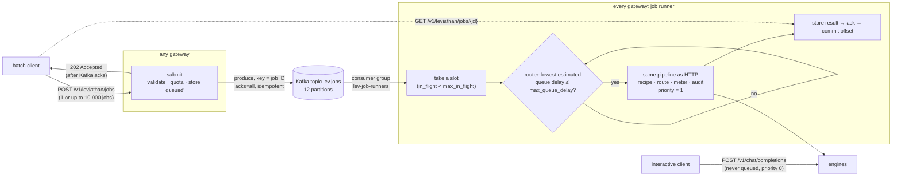

# Illustrated 09: Bursts, Kafka and admission control

> Code: `crates/lev-gateway/src/jobs/` (`mod.rs` runner and admission, `queue.rs`, `kafka.rs`, `offsets.rs`), `crates/lev-router/src/lib.rs` (`min_queue_delay`), `worker/leviathan_worker/backends/sim.py` (`_enqueue`, priority)
> Tests: `crates/lev-gateway/tests/gateway.rs` (`jobs_*`), `crates/lev-gateway/tests/kafka.rs` (real broker), `crates/lev-control/tests/services.rs` (job store on Postgres), `jobs/offsets.rs` unit tests
> Real data: `scripts/burst_sweep.sh` + `lev-burst` on `scripts/dev.sh unified 4` (sim, `h200-vllm` profile), results in `bench/results/burst/`
> Previous: [08 Observability and replay](08-observability-and-replay.md)

## The problem: a burst lands in the engines' queues

Eight interactive clients run a closed loop of agent requests (~1.7k-token shared system prompt, 64 output tokens) against four replicas. At t = 8 s a batch job sends 2000 requests at once (unique ~2k-token prompts, 256 output tokens). Sent straight to `/v1/chat/completions`, every one of them is admitted to an engine immediately, and the engines' waiting queues are FIFO:

```
interactive requests started per second, and their TTFT p50   (bench/results/burst/memory/direct)

t (s)    6     7     8        9        10       11       12       13 … 41
n        23    23    3        1        2        1        2        0  …  0
TTFT     32ms  32ms  25.9 s   38.0 s   37.1 s   36.5 s   35.7 s   –
                     ▲ burst arrives: 2000 requests ahead of every interactive one
```

From t = 13 s to 41 s not a single interactive request *starts*: all eight clients are stuck waiting for a first token. That is also why the p50 of this run is a misleading number (56.5 ms): a closed-loop client that is stuck sends nothing, so the slow period contributes only eight samples and the fast recovery after the burst contributes the rest. The honest measures are the tail and the **interactive throughput**: 1.0 request/s during the burst against 22.4 without it.

## The shape: accept now, run when there is room



- **Accepting is cheap and bounded.** A submission validates the endpoint and model, checks the tenant's monthly quota, writes the jobs as `queued` and produces them to Kafka. Measured: a batch of 500 jobs is accepted in 99 ms on Kafka (37 ms with the in-process queue). RPM/TPM limits do not apply at submission; they exist to protect the engines, and here the runner does that. Usage is still charged when a job runs.
- **A job runs through exactly the same pipeline** as an HTTP request, as the tenant that submitted it, non-streaming: recipe conversion, routing, metering, the audit log. `GET /v1/leviathan/jobs/{id}` returns the protocol response it produced (chat completion, Responses object or Anthropic message).
- **Interactive traffic is never queued behind jobs.** It does not go through Kafka, and the runner backs off when it loads the cluster.

## Admission: two knobs and an engine priority

The runner starts a job only when both hold:

1. **`in_flight < max_in_flight`**: the hard bound on what the job queue adds to the cluster.
2. **`router.min_queue_delay(model) ≤ max_queue_delay`**: the router's own TTFT model ([04](04-cache-aware-routing.md)) without the request's prefill, on the least-loaded healthy worker:

```
delay(worker) = pending_prefill_tokens × prefill_us_per_token + decode_interference_us × sequences
                (30 µs per token, 2 ms per sequence by default)
```

So the gate measures room in the same unit the router routes by. With no worker up the delay is undefined and the gate stays closed: during an outage jobs wait in the queue instead of failing (test `jobs_wait_out_an_outage_in_the_queue`).

Two details make the gate honest:

- **Poll once before the next check.** A job that passed the gate is invisible to the router until it is tokenized and routed. The runner polls the job's future once (`futures::poll!`) before looking at the next job: by then `prepare` and `router.route` have run synchronously and the job's load is in the router's accounting. Without that, a burst would pass the gate `max_in_flight` times in one millisecond.
- **Engine priority.** Job requests carry `priority = 1`, interactive ones 0. The sim engine keeps its waiting queue ordered by priority, FIFO within one (test `test_lower_priority_value_is_admitted_first`); vLLM does the same with `--scheduling-policy priority`. Running sequences are not preempted.

Both knobs and the priority change at runtime: `PUT /admin/jobs {"max_in_flight": 256, "max_queue_delay_ms": 400}` opens the tap at night and closes it in the morning.

## Measured: a Pareto curve, not a free win

Same cluster, same burst, eight runs (`bench/results/burst/memory/`; "during" is from the burst's arrival until it finished or the 60 s run ended):

| Burst sent as | Burst finished in | Interactive TTFT p50 | p99 | max | Interactive req/s |
| --- | --- | --- | --- | --- | --- |
| no burst | – | 31.5 ms | 40.7 ms | 54.5 ms | 22.4 |
| **direct** | **42.4 s** | 56.5 ms ¹ | 38 047 ms | 38 047 ms | 1.0 |
| jobs, 32 / 50 ms | 116.7 s | **34.6 ms** | **103.2 ms** | 149.5 ms | **15.3** |
| jobs, 64 / 100 ms | 78.1 s | 37.1 ms | 149.0 ms | 172.7 ms | 11.5 |
| jobs, 128 / 200 ms | 59.5 s | 72.8 ms | 228.1 ms | 291.9 ms | 7.5 |
| jobs, 256 / 400 ms | 49.7 s | 114.1 ms | 420.7 ms | 434.4 ms | 5.1 |
| jobs, 512 / 2000 ms | 44.7 s | 195.3 ms | 524.8 ms | 545.3 ms | 3.1 |

<sub>¹ Coordinated omission: stuck clients send nothing, see above. Labels are `max_in_flight / max_queue_delay`. All 2000 burst requests succeeded in every run; no interactive request failed.</sub>


What the numbers say:

1. **The queue protects interactive latency.** At the default limits (32 / 50 ms) interactive TTFT p99 is 103 ms instead of 38 s, and interactive clients keep 68% of their throughput instead of 4%.
2. **It is paid for in burst completion time.** The same burst takes 116.7 s instead of 42.4 s, because it runs at most 32 at a time. The knobs trace the trade-off: at 512 / 2000 ms the burst finishes in 44.7 s, 5% slower than direct, and interactive p99 is still 525 ms instead of 38 s.
3. **Interactive throughput falls even when TTFT does not.** From 32 to 512 in flight, TTFT p99 stays under a second but interactive throughput drops from 15.3 to 3.1 requests/s. Priority reorders *admission*; it does not shrink the decode batch, and every running job makes every engine step longer (TPOT). The knob is really "how much of the GPUs the batch may have".

### Ablation: the gate or the priority?

| Limits | Job priority 1 | Job priority 0 (same as interactive) |
| --- | --- | --- |
| 128 / 200 ms | p99 228.1 ms, 59.5 s | p99 239.2 ms, 59.2 s |
| 512 / 2000 ms | p99 524.8 ms, 44.7 s | p99 2087.1 ms, 44.7 s |

With tight limits the gateway's admission does the work: the engines' waiting queues stay short, so there is little to reorder and priority changes nothing (228 vs 239 ms). With loose limits jobs fill the waiting queues, and engine priority is what keeps the interactive tail four times shorter (525 vs 2087 ms). The two mechanisms cover different regimes, so both are kept.

### Kafka or in-process: the same curve

| Limits | Queue | Burst finished in | Interactive p99 | Submit 500 jobs (p50) |
| --- | --- | --- | --- | --- |
| 32 / 50 ms | in-process | 116.7 s | 103.2 ms | 37.0 ms |
| 32 / 50 ms | Kafka | 116.1 s | 100.5 ms | 99.4 ms |
| 128 / 200 ms | in-process | 59.5 s | 228.1 ms | 35.3 ms |
| 128 / 200 ms | Kafka | 58.9 s | 236.3 ms | 138.9 ms |
| 512 / 2000 ms | in-process | 44.7 s | 524.8 ms | 36.4 ms |
| 512 / 2000 ms | Kafka | 44.7 s | 524.0 ms | 99.4 ms |

<sub>`bench/results/burst/kafka/`, one gateway, local single-broker Kafka 4.1 in Docker.</sub>

Admission, not the queue, decides latency and throughput; Kafka costs about 60–100 ms per submission (`acks=all`, idempotent producer) and buys what an in-process channel cannot: the backlog survives a gateway restart, any gateway can accept a job, and every gateway can run them.

## What Kafka adds: many runners, one backlog, no lost jobs

### Two gateways, one killed mid-burst

Two gateways in consumer group `lev-job-runners` (6 of the 12 partitions each), Postgres as the shared job store (`deploy/local/kafka-postgres.toml`), 2000 jobs submitted to gateway A, gateway B killed with `kill -9` after 20 s (`bench/results/burst/failover/`):

```
t = 20 s   finished: A 231, B 237         kill -9 B  (32 jobs running on it, offsets not committed)
           rebalance: A takes B's six partitions, resumes at each one's committed offset
t = 106 s  all 2000 succeeded; A finished 1762 in total

SELECT status, attempts, COUNT(*) FROM jobs GROUP BY 1, 2;
  succeeded | 1 | 1968
  succeeded | 2 |   32       ← exactly B's 32 in-flight jobs, run again on A
```

No job was lost and no job failed. The 32 re-runs are the price of at-least-once delivery, bounded by the dead runner's `max_in_flight`.

### Committing offsets when jobs finish out of order

A runner works on many jobs of one partition at once, and they finish in any order. Committing the offset of a job that finished while an earlier one is still running would skip the earlier job if the runner died. `OffsetTracker` commits each partition's **lowest offset still in flight**, or one past the highest finished when nothing is (unit test `commits_stop_at_the_lowest_job_in_flight`):

```
in flight            10  11  12  13        commit position
start 10–13          ●   ●   ●   ●         10
11, 13 finish        ●   ✓   ●   ✓         10   (10 still running: nothing to commit)
10 finishes          ✓   ✓   ●   ✓         12
12 finishes          ✓   ✓   ✓   ✓         14
```

Against a real broker (`unacknowledged_jobs_are_redelivered_to_the_next_runner`): a runner takes jobs 0–2, finishes 0 and 2, and dies; the committed offset is 1, and the next runner of the group receives 1, 2, 3, 4. Job 2 arrives a second time; the store's claim turns redeliveries of finished jobs into no-ops (`claim_job` only claims `queued` or `running` jobs), so it does not run again. When a partition moves to another runner, the rebalance callback commits the tracker's position for it synchronously before letting go.

### Two things the build got wrong first

- **Keyed by tenant.** The first version keyed messages by tenant, to keep a tenant's jobs in order. Jobs are independent and need no order, and the key put one tenant's whole burst on one partition: one runner, however many gateways. They are keyed by job ID now and spread evenly (test `one_tenants_burst_spreads_over_partitions`).
- **Lag on the polled consumer.** `/admin/jobs` first queried committed offsets and watermarks through the consumer the runner was polling, and took 6.1 s per call. A separate metadata client answers in 13–31 ms.

## Why it is built this way

- **Why not put every request through Kafka?** An interactive request needs its first token in tens of milliseconds and a stream back to the client that sent it. A queue in that path adds a produce, a fetch and a hand-back of the stream to the right gateway for nothing: the gateway can already admit or reject (429 with `Retry-After`) synchronously. The queue is for work whose caller can wait, which is exactly the work that arrives in bursts.
- **Why at-least-once and not Kafka's exactly-once?** Kafka transactions make Kafka-to-Kafka pipelines exactly-once; the side effects here are GPU work and a row in Postgres, which a Kafka transaction cannot roll back. At-least-once plus an idempotent claim gives each job one stored result; the cost is re-running what a dead runner had in flight (32 jobs above).
- **Why gate on the router's TTFT estimate rather than GPU utilization or a fixed rate?** It is the quantity interactive users feel, in the same unit the router already optimizes, available per worker without asking the engines. A fixed rate is wrong whenever prompt lengths or the interactive load change; utilization says nothing about queueing.
- **Why both a cap and a delay bound?** The delay estimate lags reality by one routing decision and knows nothing about decode cost per job; the cap bounds the worst case regardless of how wrong the estimate is.
- **Why does the runner hold its consumer while waiting for headroom?** Not reading is how backpressure reaches Kafka: the backlog stays in the topic, visible as lag, rather than in the gateway's memory. `max.poll.interval.ms` is raised to 15 minutes so that a long pause does not cost the runner its partitions.
