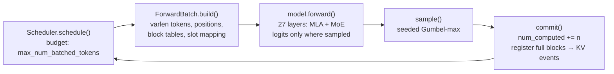

# Illustrated 10: Leviathan's own engine

> Code: `engine/lev_engine/` (`models/deepseek_v2.py`, `kv_cache.py`, `scheduler.py`, `sampler.py`, `batch.py`, `ops/reference.py`, `ops/triton/kernels.py`), `worker/leviathan_worker/backends/lev_backend.py`
> Tests: `engine/tests/` (against transformers in float64; Triton kernels bit for bit under `TRITON_INTERPRET=1`; the worker backend), CI job `engine`
> Real data: scheduler traces from the tiny test checkpoint (below); H200 measurements from `deploy/slurm/engine_h200.sbatch` (pending, see the end)
> Previous: [09 Bursts, Kafka and admission control](09-bursts-and-kafka.md) · Next: [11 Speculative decoding](11-speculative-decoding.md)

Up to chapter 09, everything below the gateway was someone else's engine (vLLM) or a simulation of one. `lev-engine` is the part of the stack where Leviathan owns the KV cache, the scheduler, the kernels and the numerics. It serves DeepSeek-V2 checkpoints (MLA + DeepSeekMoE; V2-Lite is 15.7 B parameters, 2.4 B active, and fits one H200) and plugs into the worker as `--backend lev`, so the gateway, router, KV events and benchmarks of the earlier chapters run on top of it unchanged.

## MLA: what the cache holds

Multi-head latent attention caches one compressed vector per token and layer instead of per-head keys and values. From DeepSeek-V2-Lite's `config.json`:

```
per token, per layer          values   × 27 layers × 2 B (bf16)
MLA cache: c_kv + k_rope      512 + 64 = 576        31 104 B   (30.4 KiB / token)
expanded K and V              16 × 192 + 16 × 128   276 480 B  (270 KiB / token)
                                                     8.9× more
```

The engine never expands it. `W_UK` (the key half of `kv_b_proj`) is folded into the query and `W_UV` applied after the attention, so attention runs directly over the 576-value latents:

```
q_nope [T, 16, 128] ──W_UK──▶ q_latent [T, 16, 512] ─┐
q_rope [T, 16, 64]  ──RoPE─────────────────────────────┼─▶ scores = q_latent·c_j + q_rope·k_rope_j ─▶ softmax
                                                       │                                          │
cache  [blocks, 16 tokens, 576] = (c_kv 512 | k_rope 64)┘        out_latent = Σ p_j · c_j  ◀──────┘
                                                                  out = out_latent ──W_UV──▶ [T, 16, 128] ─▶ o_proj
```

Prefill and decode take this same path. A decode-optimised engine would expand K/V for prefill (cheaper FLOPs on long prompts); `lev-engine` does not, because it is what lets a token's numerics be independent of whether it was computed in a prefill chunk or a decode step (see batch invariance).

## One step



Every scheduled token of every sequence goes into one flattened batch: a decode contributes one row, a prefill chunk many, and per-sequence metadata (`query_start_loc`, `seq_lens`, `block_tables`, `slot_mapping`) tells the kernels where each sequence's tokens and cached context are. Logits are computed only for the last row of a sequence whose prompt is complete.

## Chunked prefill, measured

Three requests (29-, 33- and 4-token prompts, 3 output tokens each), block size 4, a budget of 16 tokens per step: an actual run of the scheduler on the tiny test checkpoint.

```
step  seqs  tokens  free blocks  sampled
0     1     16      60/64        –                   A's prompt, tokens 0-15
1     2     16      55/64        A                   A's last 13 + B's first 3
2     2     16      51/64        A                   A decodes 1, B prefills 15
3     2     16      55/64        A (done), B         B's last 15 + A's final decode
4     2      5      54/64        B, C                C's whole prompt (4) + B decodes
5     2      2      62/64        B (done), C
6     1      1      64/64        C (done)
```

A long prompt never takes a whole step: from step 1 on, decodes and prefill chunks share the budget, which is what keeps TPOT flat while other requests are prefilling. Running sequences are served first in priority order (interactive 0 before batch jobs 1, the jobs of [09](09-bursts-and-kafka.md)), then waiting ones are admitted with the remaining budget.

## Out of blocks: preemption meets the prefix cache

The same three requests with 12 output tokens and only 20 blocks:

```
step  seqs  tokens  preempted  free  sampled
0     3     64      0           2    A, B          A and B prefill whole, C gets the last 2 tokens of the budget
1-3   3      3-4    0           1-2  A, B, C
4     2      2      1           1    A, B          C preempted (lowest priority = latest arrival)
8     1      1      1          10    A             B preempted
11    1      1      0          20    A (done)
12    2      8      0           7    B, C          both re-admitted: 8 tokens recomputed, not 48 (41 + 7)
13-20 …                                          B and C finish
```

Preemption is by recomputation: the victim's blocks are released and it goes back to the waiting queue. Its *full* blocks stay in the prefix cache (evictable, LRU), so when it is re-admitted at step 12 the scheduler's prefix lookup finds most of them and only 8 tokens are recomputed for the two sequences. The outputs are identical to a run with enough memory (`test_preemption_recomputes_to_the_same_tokens`).

## The prefix cache speaks the router's hash

A full block is registered under the chain hash of its prefix, the convention of [03](03-prefix-index.md) (`h[i] = xxh3_64(le_u32(tokens of block i), seed = h[i-1])`). Measured on the run above: after `A` finished, sending its prompt again served **28 of its 29 prompt tokens** from cache (7 full blocks; the last token is always computed, its logits are needed).

```
in use (ref > 0) ──last user frees──▶ evictable (cached, LRU) ──allocation needs it──▶ free
        ▲                                     │                    emits BlockRemoved
        └───────── prefix hit (ref += 1) ─────┘
register(full block) emits BlockStored(hash, parent)
```

Because the hashes are the router's own, the `lev` worker publishes the engine's events as they are. vLLM's had to be re-hashed ([07](07-vllm-on-h200.md)). A test checks the engine's hashes against the worker's (`test_prefix_cache_hits_and_events_follow_the_router_convention`).

## Batch invariance

The replay of [08](08-observability-and-replay.md) is exact on the sim and only approximate on vLLM, because a request's numbers on a real engine depend on what else is in its batch. The causes, and what each `lev-engine` kernel does about them:

| Source of batch dependence | Where | `lev-engine` |
| --- | --- | --- |
| GEMM picks split-K / tile shapes by M | cuBLAS, every linear layer | `batch_invariant=True`: one Triton tile config (64×64×32) for every M, no split-K; K is always reduced in the same steps |
| Attention splits the KV by batch size (flash-decoding) | decode kernels | one program per query token, all 16 heads (they share the latent KV); the context is reduced in 32-token chunks from position 0, whatever the batch |
| Prefill and decode use different math | MLA expand vs absorb | absorbed path for both |
| MoE output depends on which tokens share an expert | grouped GEMM with atomics | sorted-by-expert grouped GEMM, no atomics; top-k outputs summed in a fixed order |
| Norms reduce across a tile of rows | some fused kernels | one program per row |
| An op outside the kernels | the MoE router's fp32 GEMM was a bare matmul (BLAS / cuBLAS) | goes through `ops.linear` like every other GEMM; `test_the_whole_model_is_batch_invariant` checks the model, not just the kernels (found while chasing a CI-only failure of chapter 11's bit-for-bit test) |
| Sampling noise from a shared RNG stream | `torch.multinomial` | noise is a hash of (seed, output index, vocab id); Gumbel-max sampling |

The sampler draws exactly from softmax(logits / T) without a stateful generator:

```
token = argmax_v ( logits_v / T + g_v ),   g_v = −log(−log u_v),   u_v = splitmix64(seed, step, v) / 2^53
```

so a request with a given seed samples the same tokens alone, next to 63 others, after a preemption, or on replay (`test_seeded_sampling_does_not_depend_on_the_batch`). The kernel tests check the property bit for bit: a row of the GEMM, a decode token's attention and a token's MoE output are the same alone as in a larger launch (`test_*_batch_invariant`, under the Triton interpreter in CI; on the GPU in the H200 job).

What it costs (fixed tiles waste work at small M; no split-K or split-KV for small batches) is measured on the H200 below.

## Correctness

| Test | What it pins down |
| --- | --- |
| `test_prompt_logits_match_transformers` | the engine's logits for every position equal transformers' DeepseekV2 in float64, for the whole prompt in one step, in chunks of 5/11/1/20, and one token at a time over a scrambled block table; with and without q-LoRA, greedy and group-limited routing |
| `test_greedy_matches_transformers_with_chunked_prefill` | 6 requests, 16-token budget: greedy outputs equal `transformers.generate` |
| `test_preemption_recomputes_to_the_same_tokens` | a 24-block pool preempts; outputs equal a run with 256 blocks |
| `test_engine_on_triton_matches_reference_backend` | the Triton batch-invariant backend generates the same tokens as the PyTorch reference |

The float64 comparison uses an fp32-sized tolerance (1e-5 relative) because transformers itself rounds RoPE and the attention softmax through fp32; a real bug is off by 1e-2 or more. One bug the tests caught while building: `ScheduledSeq.completes_prompt` was a property read after `commit()` had advanced `num_computed`, so sequences sampled mid-prompt and stalled; it is now fixed when the step is scheduled.

## Measured on H200

Pending: `deploy/slurm/engine_h200.sbatch` (DeepSeek-V2-Lite-Chat, one H200, bf16) measures logits parity with transformers, batch invariance under three kernel configurations, kernel microbenchmarks against cuBLAS and the reference, and offline throughput against vLLM on the same GPU. The tables go here when it has run.

## Why it is built this way

**Why write an engine when vLLM exists?** To own the parts that decide behaviour under load: what the cache holds and evicts, who gets the next step's tokens, and the numerics. Two things in Leviathan needed that ownership: exact replay (batch invariance) and KV events in the router's convention without translation.

**Why DeepSeek-V2-Lite and not V4?** V4's attention (compressed sparse attention with an indexer, mHC residual streams) is a research project of its own, and V4.1-Flash does not fit the GPUs available (≤ 2 per job on Explorer). V2-Lite has the two DeepSeek ideas that shape an engine, MLA and fine-grained MoE, with real weights on one H200.

**Why absorb `W_UK`/`W_UV` instead of expanding K and V?** Decode reads the cache once per token: 576 values per token instead of 5 120 is the whole point of MLA. Absorbing for prefill too costs FLOPs on long prompts, and buys one numerical path for every token.

**Why preempt by recomputation, not by swapping to CPU?** With prefix caching, a preempted sequence's full blocks stay cached; re-admission usually recomputes a block or two (8 tokens for two sequences in the trace above). Swapping would add a host-memory tier and copy streams for what the cache already gives back. A CPU tier for cold prefixes is a separate feature (it exists in the sim's `TieredPrefixCache`).

**Why one Triton tile configuration for all batch sizes?** Batch invariance is a property of each output element's reduction order. With split-K, or with tile shapes chosen per M, the same token's logits change with the batch. Fixing the tiles is the simplest guarantee; the price is measured, not assumed.
